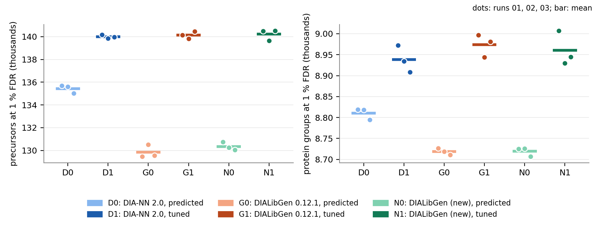
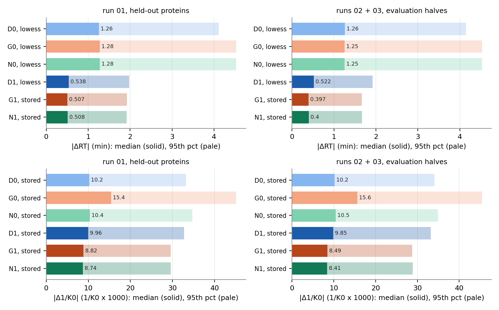

*What it does, how to use it, and how it compares with DIA-NN.*

# Summary

DIALibGen predicts DIA spectral libraries (retention time, fragment intensities, ion mobility) from a protein
FASTA and can fine-tune its retention-time and ion-mobility predictors on one of your runs. It is a single
command-line program, with a desktop app, for Linux, macOS and Windows.

Measured against DIA-NN 2.0's built-in predictor on one Orbitrap Astral dataset and a whole-proteome library:

| | DIALibGen | DIA-NN 2.0 |
|:----------------------------------------------|:-------------|:-----------|
| library from a FASTA, 5.8 M precursors, 96 CPU threads (same server, one session) | 151 s (0.13.0) | 180 s |
| the same at 16 CPU threads | 690 s (0.13.0) | 464 s |
| the same on 2 × H100 GPUs, 16 CPU threads | 49 s (0.13.0) | – (not measured) |
| median \|ΔRT\| (min), 16,068 held-out precursors, LOWESS-calibrated; untuned → fine-tuned on the same training peptides (0.11.1) | 0.243 → **0.093** | 0.290 → 0.142 ¹ |
| median cosine to observed b/y-ion intensities (z ≤ 2, raw MS2 spectra), 42,785 precursors (0.11.3) | **0.941** | 0.839 |
| precursors passing DIA-NN 2.0's estimated 1 % FDR, run 01, untuned → fine-tuned library (0.11.1; the tuned libraries were trained on this run) | 89,232 → **96,156** | 88,130 → 90,843 |

¹ A second DIA-NN tune, trained on DIA-NN's own search results (more training precursors, validation proteins
included), reached 0.099 min (section 4).

On a MacBook Pro (Apple M4 Max, 16 cores) DIALibGen 0.13.0 generates the same 5.8 M-precursor library in 476 s
on the CPU and in 344 s with the fragment model on the Apple GPU, its default route there (297 s when RT and CCS
are predicted before, not during, the GPU phase; section 3); the Astral library is fine-tuned in 69 s with GPU
training, the default on Apple silicon. The
server runtime rows above were measured on 20 October 2026 with the DIALibGen 0.13.0 release package and DIA-NN 2.0
on the same server, one after the other, on a non-public human-plus-entrapment FASTA (5.81 M precursors). Each tool's time
includes its own fragment selection and output format. The accuracy and identification rows use libraries
made with 0.11.1 and 0.11.3 on the public human FASTA (3.49 M precursors); 0.11.4 generates the same CPU library
content (checked for the generated Astral library and one CPU tune; tuned libraries depend on the training
setup). The CPU timings for the two tools come from two identical machines (section 3). The Astral accuracy
tables use run 01 of the ProteoBench Astral DIA dataset (section 4).

On timsTOF (diaPASEF, three public runs; section 6, DIALibGen 0.13.0) the two predictors are equal once tuned
(DIALibGen 140.2 k, DIA-NN 2.0 140.0 k precursors per run at DIA-NN's 1 % FDR, confirmed by an entrapment check);
untuned, DIALibGen finds 3.8 % fewer. Its tuned RT and 1/K0 are the more accurate (median |ΔRT| 0.51 against
0.54 min, |Δ1/K0| 0.0087 against 0.0100), and since 0.13.0 its untuned 1/K0 is corrected to the accuracy of DIA-NN's.

# 1. What DIALibGen is

DIALibGen digests a protein FASTA in silico and predicts, for every precursor, the retention time (RT), the
fragment-ion intensities and, for instruments that separate ions by mobility (timsTOF), the collisional cross
section (CCS), from which it derives the inverse reduced ion mobility (1/K0, in V·s/cm²); since 0.12 a library for
an instrument without ion mobility (Astral, other Orbitraps) carries no CCS or 1/K0. Prediction uses the open AlphaPeptDeep models, run through ONNX Runtime from C++; digestion,
modifications and file handling use OpenMS. Prediction runs on the CPU or on NVIDIA GPUs. DIA-NN 2.0 predicts
libraries itself; DIALibGen is a standalone, scriptable predictor that also writes OpenSWATH formats, records
how each library was made, and can fine-tune its RT and CCS models on your own run.

Release packages exist for Linux (x64, arm64), macOS (Intel, Apple silicon) and Windows (x64): a command-line
archive and a desktop app that drives the same program. The prediction models are bundled. Since 0.11.4 the
macOS release uses the Apple GPU: fine-tuning trains there by default on Apple silicon
(`-machine:device auto` resolves to Metal, MPS); since 0.12.1 `auto` also predicts the fragments there
(CoreML) for libraries of at least 50,000 precursors per CPU thread, and `-machine:device coreml` does so for any
size (RT and CCS stay on the CPU, which CoreML cannot replace for these models).
`-mode prepare` compiles the GPU shapes of the fragment model once, ahead of a first run. Since 0.12.1 the Linux
packages include ONNX Runtime's CUDA build, so prediction runs on an NVIDIA GPU when the CUDA 12 runtime and
cuDNN 9 are installed, and on the CPU otherwise.

## Modes

Every RT in a library must be on a single scale, because a search engine calibrates the library as a whole.
DIALibGen libraries carry RT either on the model's normalised 0–1 scale (freshly predicted; optionally rescaled
to the indexed RT scale, iRT, with `-generation:irt_rescale true`) or in the minutes of one run (observed or
tuned values). The mode rules below exist to prevent mixing the two. Ion mobility (1/K0) can also be predicted
or observed, but has no scale problem.

| mode | input | output |
|:-----------|:-------------------------------------|:-------------------------------------------|
| `generate` (default for a FASTA) | protein FASTA | predicted library: RT, fragment intensities (and, with ion mobility, CCS and 1/K0) for every precursor of the digest |
| `refine` | library + identifications from one run | observed RT (and, with `-write_im`, 1/K0) written into the library; by default only the identified precursors are kept |
| `tune` | library + identifications from one run | the whole library re-predicted with RT and/or CCS models fine-tuned on that run; with the RT model tuned, RT in that run's minutes |
| `convert` (default for a library) | library | the same library in another format |
| `prepare` (macOS) | – | the fragment model's CoreML shapes compiled into the cache, for later `-machine:device coreml` runs |

**generate** needs no run data. It digests the FASTA, enumerates the precursors (charges, modifications,
m/z range), predicts RT, fragment intensities (b/y ions, charge 1–2 by default) and, for an instrument with ion
mobility, CCS, derives 1/K0 from the CCS (by default), and writes the library.

**refine** writes observed values; it does not tune by default.

1. Read the DIA-NN report of one run (a multi-run report is refused).
2. Keep the rows that pass the q-value thresholds (an estimated 1 % false discovery rate, FDR), by default 0.01
   each for the precursor, global and protein q-values (a threshold of 1 turns that gate off). An enabled gate needs its column; a missing column is an error. Decoys and rows with
   an invalid q-value or charge are dropped.
3. Match the rows to library precursors by modified peptide sequence (UniMod spelling normalised) and charge.
4. By default keep only the matched, identified precursors.
5. Replace their RT with the observed RT. Optionally (`-write_im`) replace 1/K0 as well, for charges of at
   least `-im_min_charge` (2); the CCS derived from the old 1/K0 is then blanked. If the instrument's mobility
   ramp top is given (`-im_ramp_top`), observations within `-im_ramp_margin` (0.02) of it are treated as
   missing and the prediction stays. Optionally (`-write_intensity`) copy in observed fragment intensities;
   this needs a report with fragment quantities (`--report-lib-info` or `--export-quant`) and applies a
   fragment-quality gate.
6. `-out_report` writes the residuals measured *before* the overwrite; after it they would be zero by
   construction.

Two cases would mix the scales: keeping unidentified precursors (`-no_filter`), or an observed RT for only some
of the identified ones. Both are refused unless RT is left alone (`-no_write_rt`) or the library is first
re-predicted in the run's minutes by `-tune -tune_heads rt|both`, which runs the tune procedure, then step 5.
CCS-only tuning does not fix the RT scale and is refused there. A filtered library also changes the next search:
precursors missed in the first run stay missed, and the error-rate estimate refers to that smaller set.

**tune** adapts the models; it writes no observed values and removes nothing. Defaults in brackets.

1. Read the report (one run; protein groups are needed), keep rows with q ≤ `-filter:q_value` (0.01), drop
   decoys, rows without a protein group and, for CCS, charges below `-filter:min_charge` (2).
2. Build training units: one per modified sequence for RT, one per sequence and charge for CCS; the observed
   value is the median over the unit's rows. For RT, a sequence whose rows spread by more than
   `-filter:rt_spread_max` (0.2 min) is dropped. The RT target is the observed RT divided by the largest
   observed RT among the units, or by `-filter:rt_max_minutes` if that option is set, so targets lie in 0–1; the CCS target is computed
   from the observed 1/K0, m/z and charge.
3. Split by protein group with a hash: about one group in five goes to a test set, one in seven of the rest to
   a validation set, the remainder is the training pool (the shares in sequences come out as 20 % and 13 % in
   section 4). Each of test and validation needs at least 100 units,
   otherwise the tune is refused (`-cohort:` options change this split).
4. Fine-tune the pretrained AlphaPeptDeep RT (or CCS) network: Adam, peak learning rate 1e-4 with a linear
   warm-up and cosine decay, mean absolute error as the loss, mini-batches of 1,024, gradient clipping, up to
   `-train:epochs` (100) passes over the training units; the LSTM initial states stay frozen.
5. After each epoch (`-stop:eval_every` 1), score the validation set: by default the standard deviation of the
   residuals after a straight-line calibration. A checkpoint is kept only if it beats the pretrained
   ("stock") model on validation; if none does, the tune is refused. Training stops after `-stop:patience` (10) epochs without an
   improvement of at least `-stop:rel_tol` (0.5 %) over the best so far, never before epoch 20, or earlier at
   the epoch or time budget.
6. Report the test-set metrics; under the default cohorts the test set never took part in selection.
7. Re-predict the **whole** library with the tuned model(s), identified and unidentified precursors alike. With
   the RT model: RT = model output × the denominator of step 2, so the library is in the run's minutes. Fragment
   intensities, precursor keys and m/z are unchanged.
8. Record the recipe (cohorts, settings, seed, thread count) in the Parquet output or the `.refine.json`
   sidecar of a TSV, and in the tuned ONNX files, which are kept only with `-tune_out_models`. CPU training uses
   `-machine:train_threads` (16 on Linux and Windows, 8 on macOS); on Linux the tuned weights depend on that
   number, on macOS they do not (4, 8 and 16 threads gave identical weights). Training on a GPU (CUDA in
   a source build, or Metal on Apple silicon) is not bit-identical to the CPU.

On data without ion mobility (Astral, Orbitrap), pass `-tune_heads rt`: the default `both` needs observed
1/K0 in the report.

**convert** writes an existing library in another format without changing its content. Every mode can write
DIALibGen Parquet (one row per precursor, with the recipe and input checksums embedded), DIA-NN TSV (read by
DIA-NN 1.7 and 2.x), DIA-NN 2.0's Parquet layout (`-out_format diann2_parquet`) and OpenSWATH PQP or TSV
(`-out_format openswath_tsv`). DIA-NN reads the TSV and its own Parquet layout, not DIALibGen's Parquet.

**Where the identifications come from.** `refine` and `tune` take one run's identifications from a DIA-NN
report (`-ids report.parquet`); this is the validated route and the one used throughout this report.
Alternatively, `-run` gives them the run itself (centroided mzML or mzPeak): DIALibGen then searches the run,
writes its identifications as a report and continues exactly as with `-ids`. `-run` is not a mode of its own,
and it is experimental: its validation is not complete (error-rate control checked with entrapment
sequences, i.e. sequences that cannot be in the sample and so expose false identifications; and resource
limits). With `-run`, `-write_intensity` is not available; the CCS head and `-write_im` need a diaPASEF run
converted with its per-peak 1/K0 values and searched with ion mobility; the intended form is
`-mode refine -tune -no_filter`.

A typical workflow:

1. `generate` a library from the FASTA (DIA-NN TSV, or `-out_format diann2_parquet`);
2. search one representative run with DIA-NN and that library;
3. `refine` with that search's report (a library carrying the observed RTs, an "empirical" library), or
   `tune` (an adapted predicted library), or `refine -tune -no_filter` for both; `tune` picks RT, plus CCS when the
   report has ion mobility (`-tune_heads auto`, the default since 0.12);
4. search the other runs with the result.

With DIA-NN 2.x, for an Astral run (DIALibGen 0.13.0; all physical cores by default):

```bash
DIALibGen -in proteins.fasta -out predicted.tsv -generation:instrument Astral
diann --f run01.raw --lib predicted.tsv --fasta proteins.fasta --reannotate \
  --met-excision --out first_pass.parquet --threads 16
DIALibGen -mode tune -in predicted.tsv -ids first_pass.parquet -out tuned.tsv
```

Choose `-generation:instrument` for your instrument (the Astral results here use `Astral`, which selects
AlphaPeptDeep's Lumos-group fragment model). Since 0.12.1 the instrument's file of defaults also sets the NCE,
the m/z windows and the charges: for `Astral` NCE 25, precursor m/z 380–980, fragment m/z 150–2000 and charges
1–4, the settings of this report's Astral libraries; for `timsTOF` m/z 350–1200 / 200–1800, charges 1–4 in 0.12.1
and 2–4 since 0.13.0, which also corrects the predicted 1/K0 (timsTOF section); other instruments use the
generic defaults (350–1200 / 200–1800, charges 1–4). Match digestion,
modifications, charges and m/z ranges to the experiment. Modifications are given by name (OpenMS or UniMod),
one per residue; this report evaluates only carbamidomethylated cysteine and oxidised methionine, and
accuracy for other instrument settings or modifications is not established here. A whole human proteome
takes 5–10 GB of RAM to generate and 6–7 GB to tune (section 3); its OpenSWATH PQP export needs about 60 GB.

Installation, the command lines of the benchmark libraries (in their 0.13.0 form), their settings and the
thread and GPU options are in Appendix A.

# 2. Data

**FASTA (sections 4 and 5).** UniProt human reference proteome UP000005640, one sequence per gene
(`UP000005640_9606.fasta`, 20,652 entries: 20,329 Swiss-Prot, 323 TrEMBL), UniProt release 2026_03, downloaded on
9 October 2026 from
<https://ftp.uniprot.org/pub/databases/uniprot/current_release/knowledgebase/reference_proteomes/Eukaryota/UP000005640/UP000005640_9606.fasta.gz>
(proteome page <https://www.uniprot.org/proteomes/UP000005640>). md5 of the uncompressed file
`503f8006bb0a3aa0e002031d5fb5ce49`. The `current_release` link moves with every UniProt release; older releases are
under <https://ftp.uniprot.org/pub/databases/uniprot/previous_releases/>.

**Runs.** The three runs of the "DIA Ion Entrapment – Astral" module of ProteoBench, a community benchmarking
platform for proteomics software:
`LFQ_Astral_DIA_15min_50ng_Human_01`, `_02`, `_03`: technical replicates of a human digest, 50 ng, 15-min
gradient (the acquisition lasts about 24 min; the identified peptides elute between 3 and 22.5 min), Orbitrap
Astral in DIA mode. Module documentation:
<https://proteobench.readthedocs.io/en/latest/modules/dia/entrapment-dia-astral/>; raw files:
<https://proteobench.cubimed.rub.de/raws/DIA-astral-entrapment/all_data_Entrapment_DIA_Astral.tar.gz>
(5.6 GB). The vendor `.raw` files were converted to mzML with OpenMS `FileConverter` (Thermo RAW reader,
development build of 9 October 2026), keeping the instrument's centroided peaks. The module's own pre-digested
entrapment FASTA was not used here; all searches used the human FASTA above. The files have no PRIDE accession
that we could identify.

**FASTA for the runtime comparison (section 3).** A proteome-sized FASTA from an earlier entrapment study,
40,862 entries: 20,431 reviewed human UniProt sequences (February 2021, with common contaminants and the
Biognosys iRT peptides) and 20,431 matched entrapment sequences (md5 `3fb427c3514e897a2d53e3f28b25967e`). It is
not public, so the runtime benchmark cannot be repeated independently; it serves only as a large input of
human-like sequences (for scale: the public FASTA above gives a 3.49 M-precursor library in 121.7 s on the same
node, section 3).

**timsTOF runs (the timsTOF section).** PXD029836 (Demichev et al., *Nature Communications* 13, 3944, 2022;
PRIDE): the dia-PASEF benchmark of the DIA-NN authors. Three 200 ng injections of a human cell lysate digest
(technical triplicate; acquisition numbers 1418, 1420 and 1422, here runs 01–03) on a timsTOF Pro 2: dia-PASEF
with 32 windows of 26 Th (m/z 400–1201) in 16 window groups, 1/K0 0.60–1.60, collision energy 20–57 eV,
104-min gradient (values read from each run's `analysis.tdf`). The FASTA is the human FASTA above. For an
entrapment check, every protein was given a shuffled twin (each tryptic segment shuffled in place, keeping its
C-terminal K/R; target-to-entrapment ratio r = 0.994).

**A second timsTOF study (calibration and checks).** PXD041421 (PRIDE): 60-min dia-PASEF runs of a human cell
line digest on two timsTOF Pro instruments (56 windows of 28 Th in 14 groups, 1/K0 0.70–1.30, collision energy
26–46 eV). One run per instrument (files ending `_3197` and `_9898`) was used to fit DIALibGen's 1/K0
correction and to check the collision-energy choice; it is not used for any other number.

**Software versions.** Seven DIALibGen versions produced the results; their libraries are the same where the table
says so. The command lines are written for 0.13.0, the release this report accompanies.

| version | used for | note |
|:----------------------------------|:-------------------------------------------------------|:-------------------------------------|
| DIALibGen 0.11.1 (release build) | library set A: accuracy and DIA-NN 2.0 identifications (sections 4, 5) | its untuned library is identical to 0.11.3's and 0.11.4's (CPU) |
| DIALibGen 0.11.2 | runtime rows that bridge the two servers (section 3) | same library as 0.11.3 |
| DIALibGen 0.11.3 (source build) | server runtime (section 3); library set B: the DIA-NN 1.7.12 identifications and the entrapment check (section 5, Appendix A) | 0.11.4 generates the same CPU library content |
| DIALibGen 0.11.4 (Homebrew cask) | laptop runs, CPU and Apple GPU (section 3) | CPU libraries equal the server's to float rounding; CoreML libraries differ slightly in fragment intensities |
| DIALibGen 0.11.5 (source build, CUDA) | server GPU runtime, one H100 (section 3) | its GPU library is byte-identical to 0.11.3's |
| DIALibGen 0.12.1 (release package, Linux x64) | server GPU runtime, one and two H100 (section 3); the control runs of the 0.13.0 runtime sessions; the 0.12.1 libraries of the timsTOF section | its GPU library equals 0.11.3's (Parquet table; only the recorded recipe differs); its Astral (Appendix A) and timsTOF (section 3) commands write the same TSV as 0.11's longer commands |
| DIALibGen 0.13.0 (release packages; timsTOF section: a source build of main at commit 79a7ec6, whose default libraries equal 0.13.0's) | runtime on the servers' CPUs and GPUs and on the laptop (section 3); the timsTOF section: the new default library (charges 2–4, corrected 1/K0) and its tuned library | Astral and other instruments without ion mobility: the same library as 0.12.1 |
| DIA-NN 2.0 (Academia, 28 Jan 2025) | predictor runtime (two sessions on kim, the second with 0.13.0); set A tuning, searches and RT reference; all timsTOF searches | |
| DIA-NN 1.7.12 (open-source Linux build) | set B training identifications and searches; intensity reference | cannot predict libraries |


# 3. Runtime against DIA-NN

**Task.** Predict a library from the 40,862-entry FASTA with identical digest settings in both tools: Trypsin/P
(DIA-NN: `--cut K*,R*`), 1 missed cleavage, length 7–30, charge 2–4, precursor m/z 350–1200, fragment m/z 200–1800, fixed
Carbamidomethyl, no variable modifications, Met excision. Both write 5,808,438 precursors. DIALibGen keeps up to 12
fragments for each (69,699,513 transitions; Parquet 766 MB) and predicts RT, fragments and CCS/1/K0 with the
`timsTOF` instrument setting, which makes both tools predict ion mobility as well, at normalised collision
energy (NCE) 30; the instrument label only conditions the fragment model and does not change the cost. DIA-NN 2.0 (Academia
build of 28 January 2025) predicts spectra, RT and ion mobility. The commands (`F` = the FASTA, `N` = threads):

```bash
diann --fasta F --fasta-search --predictor --gen-spec-lib --cut 'K*,R*' \
  --missed-cleavages 1 --min-pep-len 7 --max-pep-len 30 --min-pr-charge 2 \
  --max-pr-charge 4 --min-pr-mz 350 --max-pr-mz 1200 --min-fr-mz 200 \
  --max-fr-mz 1800 --unimod4 --met-excision --var-mods 0 --threads N \
  --out-lib lib.parquet

# DIALibGen 0.13.0 (timstof.yaml supplies charges 2-4, NCE 30 and the m/z windows)
DIALibGen -in F -out lib.parquet -generation:instrument timsTOF \
  -generation:precursor_charges 2 3 4 -generation:min_relative_intensity 0 -threads N

# the runs here used the same settings as a recipe, which every version reads:
# recipe.json: {"precursor_charges":[2,3,4],"instrument":"timsTOF",
#               "min_relative_intensity":0.0,"nce":30.0}
DIALibGen -in F -config recipe.json -out lib.parquet -threads N
```

**Machines.** `kim` and `dax` are identical servers (2 × AMD EPYC 9654, 2 × 96 cores, 384 hardware threads,
Linux); `data` and `spock` have the same CPU model (224 hardware threads online) and 2 × NVIDIA H100 PCIe each. The laptop is a MacBook Pro
with an Apple M4 Max (12 performance and 4 efficiency cores, 40-core GPU, 128 GB, macOS 26.6.2), plugged in,
the 1-minute load below 3 before every run (a low load average did not mean an idle machine: a background
indexer used about one core during several runs); it ran DIALibGen 0.11.4 from the Homebrew cask (CoreML for
the fragment model, Metal for training; the RT and CCS models stay on the CPU because CoreML has no operator for
their LSTM layers). A first 0.11.4 CPU generate that ran next to a busy 3D viewer (826.1 s) was discarded and
repeated; both libraries are byte-identical. Server CPU timings were not repeated with 0.11.4 or 0.11.5: the CPU
generation path is unchanged. The one-H100 rows of 0.11.5 were measured on `spock` with 0.11.3 as a control in the
same session, on GPU 1 with 16 CPU threads of its own socket (another user's job held most of GPU 0's memory); the
first 0.11.5 run spent 10.1 s loading its libraries before the program started (cold file cache) and was repeated.
The 0.12.1 rows (the published Linux x64 package, which ships ONNX Runtime's CUDA build, with cuDNN 9 on the
library path; the same recipe as above) were measured on `spock` on 16 October 2026 with 0.11.3 as a control in the
same session: one H100 on GPU 1 with CPUs of its own socket, as for 0.11.5, and two H100 with both GPUs idle; the
first 0.11.3 control on one H100 spent 9.2 s loading its libraries before the program started and was repeated.
Five more 0.12.1 runs on two H100 took 47.9–48.8 s. The 0.13.0 rows (20 October 2026) come from three sessions with the published release packages (Linux x64 on the servers, the Homebrew cask on the laptop), each with the previous release as a control: on `kim`, DIALibGen 0.13.0, 0.12.1 and DIA-NN 2.0 one after the other at 96 and then 16 threads (other users kept 10–14 of the 384 hardware threads busy on average, below the gate of 24); on `spock`, 0.13.0 and 0.12.1 on one and two H100 with the placement of 16 October (the GPUs idle and holding no other user's job, but other users' CPU load at 0.22–0.25 per hardware thread, the gate's limit, against 0.016 on 16 October); on the laptop, on AC power, after the owner's work on it had stopped (a first laptop session during a video call and a 3D viewer was repeated; it is not used), with 0.12.1 and 0.11.4 (the published macOS packages) as controls; a run is flagged when the 1-minute load was 3 or more at its start. The 0.13.0 library differs from 0.12.1's only in its 1/K0 column (the timsTOF correction) and the recorded recipe; one and two GPUs write the same bytes. Each configuration ran once (0.11.2 at 96 threads on `kim` three times), measured with `/usr/bin/time -v` (on the laptop `/usr/bin/time -l`), and started only when the
node was quiet (fewer than 24 hardware threads busy on `kim`/`dax`; load below 0.25 per hardware thread and
the GPUs used idle and holding no other user's job on `data` and `spock`). DIALibGen's times include the collection of a timing trace;
its overhead was not measured. DIALibGen and DIA-NN do not write the same library: DIALibGen keeps 12 fragments per
precursor and its own Parquet layout, DIA-NN its own fragment selection (not counted here) and layout. The times
are therefore end-to-end times for each tool's library, not for identical prediction work.

Table: Library generation from the FASTA, 5.8 M precursors

| tool | node | threads | wall time (s) | peak RAM (GiB) | CPU time (s) |
|:-----------------|:----|:---------------|------:|-----:|-------:|
| DIA-NN 2.0 | kim | 8 | 860.6 | 6.8 | 6,530 |
| DIA-NN 2.0 | kim | 16 | 458.5 | 7.1 | 6,567 |
| DIA-NN 2.0 | kim | 96 | 171.9 | 16.4 | 10,262 |
| DIALibGen 0.11.2 | kim | 8 | 1,155.9 | 4.2 | 9,193 |
| DIALibGen 0.11.2 | kim | 16 | 595.1 | 4.7 | 9,252 |
| DIALibGen 0.11.2 | kim | 96 | 158.2 ¹ | 9.5 | 12,309 |
| DIALibGen 0.11.2 | dax | 16 | 593.6 | 4.8 | 9,240 |
| DIALibGen 0.11.2 | dax | 96 | 157.9 | 9.5 | 12,310 |
| DIALibGen 0.11.3 | dax | 16 | 682.8 | 4.9 | 10,863 |
| DIALibGen 0.11.3 | dax | 96 | 146.2 | 9.7 | 12,532 |
| DIALibGen 0.11.2 | data | 16 + 1 × H100 | 88.9 | – | – |
| DIALibGen 0.11.2 | data | 16 + 2 × H100 | 65.2 | – | – |
| DIALibGen 0.11.3 | spock | 16 + 1 × H100 | 79.2 | 4.6 | – |
| DIALibGen 0.11.5 | spock | 16 + 1 × H100 | 79.1 | 4.7 | – |
| DIALibGen 0.11.3 | data | 16 + 2 × H100 | 47.3 | 5.0 | – |
| DIALibGen 0.11.3 ³ | spock | 16 + 1 × H100 | 79.6 | 4.7 | – |
| DIALibGen 0.12.1 ³ | spock | 16 + 1 × H100 | 77.7 | 4.6 | – |
| DIALibGen 0.11.3 ³ | spock | 16 + 2 × H100 | 48.6 | 5.1 | – |
| DIALibGen 0.12.1 ³ | spock | 16 + 2 × H100 | 48.3 | 5.0 | – |
| DIALibGen 0.11.4 | laptop | 16 (CPU) | 443.6 | 6.0 | 6,532 |
| DIALibGen 0.11.4 | laptop | 16 + CoreML, cold ² | 298.5 | 7.7 | 1,067 |
| DIALibGen 0.11.4 | laptop | 16 + CoreML, warm ² | 258.3 | 7.9 | 1,486 |
| DIA-NN 2.0 ^4^ | kim | 16 | 463.8 | 7.2 | 6,619 |
| DIA-NN 2.0 ^4^ | kim | 96 | 179.8 | 18.6 | 11,448 |
| DIALibGen 0.12.1 ^4^ | kim | 16 | 690.4 | 5.0 | 10,934 |
| DIALibGen 0.12.1 ^4^ | kim | 96 | 149.5 | 10.0 | 12,813 |
| DIALibGen 0.13.0 ^4^ | kim | 16 | 690.5 | 5.0 | 10,937 |
| DIALibGen 0.13.0 ^4^ | kim | 96 | 151.2 | 10.2 | 12,924 |
| DIALibGen 0.12.1 ^4^ | spock | 16 + 1 × H100 | 78.3 | 4.7 | 210 |
| DIALibGen 0.13.0 ^4^ | spock | 16 + 1 × H100 | 78.8 | 4.7 | 208 |
| DIALibGen 0.12.1 ^4^ | spock | 16 + 2 × H100 | 47.9 | 5.1 | 215 |
| DIALibGen 0.13.0 ^4^ | spock | 16 + 2 × H100 | 49.1 | 5.1 | 219 |
| DIALibGen 0.11.4 ^4^ | laptop | 16 (CPU) | 464.9 | 5.9 | 6,874 |
| DIALibGen 0.12.1 ^4^ | laptop | 16 (CPU) | 416.7 | 6.0 | 6,178 |
| DIALibGen 0.13.0 ^4^ | laptop | 16 (CPU) | 476.4 | 6.0 | 7,022 |
| DIALibGen 0.13.0 ^4^ | laptop | 16 + CoreML, cold ² | 345.0 ^6^ | 7.7 | 1,064 |
| DIALibGen 0.11.4 ^4^ | laptop | 16 + CoreML, warm ² | 392.3 | 7.8 | 1,648 |
| DIALibGen 0.12.1 ^4^ | laptop | 16 + CoreML, warm ² | 404.9 | 8.0 | 1,696 |
| DIALibGen 0.13.0 ^4^ | laptop | 16 + CoreML, warm ² | 343.9 | 7.9 | 1,497 |
| DIALibGen 0.11.4 ^4^ | laptop | 16 + CoreML, warm, no overlap ^7^ | 292.2 | 7.3 | 1,148 |
| DIALibGen 0.13.0 ^4^ | laptop | 16 + CoreML, warm, no overlap ^7^ | 297.1 | 7.3 | 1,222 |

¹ mean of three runs (158.10 / 158.22 / 158.24 s); every other row is a single run. CPU time = user + system.
Peak RAM = peak resident memory on the host (GPU memory not included). DIALibGen 0.11.3 was not run at
8 threads. ² MS2 model on the Apple GPU, RT and CCS on the CPU at the same time; cold: the compiled-model cache
was emptied before the run, so it includes compiling the model's shapes for the GPU; warm: the shapes are loaded
from the cache. ³ one session, 16 October 2026. ^4^ the 0.13.0 sessions of 20 October 2026, one per machine, release packages; 0.13.0 uses the default route on the laptop (`auto`: CoreML for this size) and `-machine:device cpu` for the CPU row. ^6^ the 1-minute load was 3.5 at the start (the previous run's tail). ^7^ `ODIA_OVERLAP=0`: RT and CCS predicted on the CPU before the GPU phase, not during it.

![Library generation from the FASTA, 5.8 M precursors, wall time, the 0.13.0 sessions of 20 October 2026. Left: `kim`, CPU only, DIA-NN 2.0 and DIALibGen 0.12.1 and 0.13.0 one after the other. Middle: `spock`, 16 CPU threads plus one or two H100, DIALibGen 0.12.1 and 0.13.0 in the same session. Right: the laptop (Apple M4 Max), DIALibGen 0.11.4 on 13 October and DIALibGen 0.11.4, 0.12.1 and 0.13.0 in one session on 20 October, CPU, CoreML with a warm compiled-model cache, and CoreML with RT and CCS predicted before the GPU phase (`ODIA_OVERLAP=0`). Each configuration was measured once; the two tools' libraries differ in fragment selection and layout. The earlier rows of the table are not shown.](fig/runtime.png){width=100%}

Reading the table:

- **0.13.0 against DIA-NN 2.0, same server and session (`kim`).** At 96 threads DIALibGen 0.13.0 took 151.2 s, DIA-NN 2.0 179.8 s (DIA-NN 1.19 × longer); at 16 threads DIA-NN is faster, 463.8 s against 690.5 s (1.49 ×), and needs 61 % of DIALibGen's CPU time (6,619 against 10,937 s). DIA-NN needs more memory (7.2 and 18.6 GiB against 5.0 and 10.2 GiB). DIA-NN's times are within 5 % of its earlier runs on `kim` (171.9 and 458.5 s), DIALibGen 0.13.0's within 3.5 % of 0.11.3's on `dax` (146.2 and 682.8 s); one run each, with some background load (10–14 busy hardware threads).
- **0.13.0 against 0.12.1 (controls in the same sessions).** The same time within 1.2 % on the CPU (690.5 / 690.4 s at 16 threads, 151.2 / 149.5 s at 96) and within 2.5 % on the GPUs (78.8 / 78.3 s on one H100, 49.1 / 47.9 s on two): 0.13.0 predicts as 0.12.1 does (per-charge collision energies, new in 0.13.0, are not set for timsTOF), and its timsTOF library adds only the 1/K0 correction. Both GPU times are within 1.6 % of 0.12.1's of 16 October (77.7 and 48.3 s), although the CPUs were more loaded this time.
- **Laptop, 0.13.0 against 0.12.1 and 0.11.4 (one session).** On the CPU 476.4 s (0.12.1 416.7 s, 0.11.4 464.9 s; 0.11.4 took 443.6 s on 13 October): single runs of the same prediction path, 7 % apart either way. With the fragment model on the Apple GPU and a warm cache 343.9 s (0.12.1 404.9 s, 0.11.4 392.3 s); 0.11.4's 258.3 s of 13 October did not reproduce for any version. The traces point to the overlap of RT and CCS (on 8 CPU sessions) with the GPU phase, which every version since 0.11.4 uses: with the same 3,205 fragment-model chunks, the chunks took 1,186 s summed in 0.13.0 (0.12.1 1,509 s, 0.11.4 1,446 s) with the overlap and 865 s (0.11.4 833 s) without it, the rate of 13 October (861 s); without the overlap (`ODIA_OVERLAP=0`) the library took 297.1 s (0.11.4 292.2 s). On 13 October the overlap still paid; on this evening (macOS's own background analysis was active on the idle laptop) it cost 47 s (0.13.0) to 100 s (0.11.4). Whether to stop overlapping on Apple silicon is left to a later release (the library is the same either way).
- DIA-NN 2.0 and DIALibGen 0.11.3 were not timed on the same node. DIALibGen 0.11.2 was timed on both nodes and
  the times agreed within 0.3 % (595.1 vs 593.6 s at 16 threads, 158.2 vs 157.9 s at 96). This supports
  comparing across the two nodes, but it is two measurements, not a measured error bound.
- **At 96 threads** DIALibGen 0.11.3 took 146.2 s, DIA-NN 2.0 171.9 s (DIA-NN 1.18 × longer), one run each.
- **At 8 and 16 threads DIA-NN 2.0 is faster**: 458.5 s against 682.8 s for 0.11.3 at 16 threads (1.49 ×), and
  860.6 s against 1,155.9 s for 0.11.2 at 8 threads. For libraries of the same 5,808,438 precursors, DIALibGen uses 1.2–1.7 × DIA-NN's CPU
  time. 0.11.3 is 15 % slower than 0.11.2 at 16 threads and used 17 % more CPU time there (10,863 vs 9,252 s): 0.11.2
  computed only the fragment-model outputs that are written, 0.11.3 computes the model's full output (same
  weights, neutral-loss channels included, which are never written). At 96 threads the CPU times differ by
  2 % and 0.11.3 is the faster one, because other parts of the run dominate there; the libraries are identical.
- DIA-NN 2.0 needs more memory at every thread count: 6.8–7.1 GiB at 8–16 threads (DIALibGen 4.2–4.9 GiB) and
  16.4 GiB at 96 threads (DIALibGen 9.5–9.7 GiB).
- During the DIA-NN runs, other users' jobs kept about 18 of the node's 384 hardware threads busy on average;
  during the DIALibGen runs, below 1 on `kim` and 1.6–1.9 on `dax`. The effect on DIA-NN's times was not
  measured.
- **GPU server (0.12.1, 0.11.5).** The 0.12.1 release package takes 77.7 s on one H100 and 48.3 s on two, against
  79.6 s and 48.6 s for 0.11.3 in the same session; its library equals 0.11.3's apart from the recorded recipe.
  On one H100 0.11.5 took 79.1 s, 0.11.3 79.2 s in its own session; those libraries are byte-identical. 0.11.4 was slower on NVIDIA GPUs (89.2 s on one H100 and
  57.1 s on two, against 79.3 s and 48.6 s for 0.11.3): it predicted retention time and ion mobility at the same
  time as the fragments, which helps on the Apple GPU but made the three models share an NVIDIA GPU. 0.11.5 runs
  them one after the other there again.
- **Laptop (0.11.4).** The 16-core M4 Max generates the 5.8 M-precursor library on the CPU in 443.6 s, faster
  than the server at 16 threads (682.8 s) with 40 % less CPU time. With the fragment model on the Apple GPU it
  takes 298.5 s with an empty compiled-model cache and 258.3 s once the shapes are cached; in 0.11.4 the RT and
  CCS phases run on the CPU while the GPU predicts the fragments, and the shapes are compiled in the
  background. Earlier runs on the same laptop with 0.11.3 (498.7 s CPU) and with the
  Apple-GPU development build on top of it (389.5 s CoreML, empty cache) are single runs under other
  conditions: the CoreML difference fits these changes but cannot be attributed to them entirely, and the CPU
  path is unchanged, so its difference reflects conditions. The generated library content is identical to
  0.11.3's on both paths. The laptop CPU library equals the server's up to small numerical differences and
  rare fragment-selection changes (38 of 5.8 M precursors); the CoreML library has the CPU's RT, CCS and 1/K0
  exactly and differs in fragment intensities and rare fragment selections, at the level of CUDA with TF32 off
  (Astral library: 8 of 3.49 M fragment sets, minimum cosine 0.987).

**Fine-tuning.** The Astral library of Appendix A (3,488,457 precursors): generation, then tuning the RT model on
run 01's 42,785 identifications and re-predicting the whole library.

Table: Astral library, generation and fine-tuning (wall time; peak RAM on the host)

| configuration | generate (s) | tune RT + re-predict (s) | of which training (s) |
|:---------------------------------------|------------:|------------:|------------:|
| server CPU, 96 threads (dax, one socket), 0.11.3 | 121.7 (8.8 GiB) | 181.1 (7.0 GiB) | 146 (16 threads) |
| server CPU, 96 threads (dax, one socket), 0.13.0 | 107.5 (9.0 GiB) | 159.4 (7.3 GiB) | 130 (16 threads) |
| server, 2 × H100 (data), 16 CPU threads, 0.11.3 | n/m ³ | 51.9 (6.3 GiB) | GPU |
| server, 2 × H100 (spock), 16 CPU threads, 0.13.0 ^5^ | 27.0 (4.3 GiB) | 45.9 (6.3 GiB) | 22 (GPU) |
| laptop CPU, 16 threads, 0.11.4 | 235.8 (5.4 GiB) | 638.8 (5.8 GiB) | 578 (8 threads) |
| laptop Apple GPU, CoreML (warm cache) / Metal, 0.11.4 | 157.5 (6.4 GiB) | 70.8 (6.9 GiB) | 40 (GPU) |
| laptop CPU, 16 threads, 0.13.0 | 217.8 (5.5 GiB) | 639.6 (5.9 GiB) | 580 (8 threads) |
| laptop Apple GPU, CoreML (warm cache) / Metal, 0.13.0 | 134.5 (6.4 GiB) | 69.3 (6.9 GiB) | 41 (GPU) |

³ The server-GPU generation of this library could not be timed cleanly: another user's job occupied one of the
GPUs. Writing the DIA-NN TSV took 16 s on the server. ^5^ 20 October 2026, both GPUs idle; generation with the release package, tuning with a 0.13.0 source build linked to CUDA LibTorch 2.10 (the Linux release packages train on the CPU and re-predict on the GPU).

{width=100%}

All tunes reach the same held-out accuracy: the tune's selection metric (standard deviation of the RT
residuals after a straight-line calibration) on the 8,442 held-out test units is 0.393–0.395 min for the four 0.11.x tunes and 0.393–0.395 min for the four 0.13.0 tunes, against 0.607 min for the pretrained model. That metric is the tune's internal score, not the median
\|ΔRT\| of section 4. On the laptop CPU, training is the slow part (578 of 639 s on 8 threads, the macOS
default since 0.11.4; 0.11.3 trained on 16 threads in 768 s, with 2,299 s of system time against 501 s now),
and training on the Apple GPU, the default on Apple silicon, brings it to 40 s. On this Mac, 8 and 16 training
threads gave identical tuned weights; on Linux the count changes them slightly ("Threads and GPUs"). Training is not
bit-identical across platforms: the laptop CPU's tuned RTs differ from the server's by a median of 0.022 min
(maximum 0.53), the GPU-trained ones from the laptop CPU's by 0.016 min (maximum 0.55). Part of the
0.11.3-to-0.11.4 differences on the laptop may be conditions: some 0.11.3 runs started at a higher load.

**DIA-NN 1.7.12.** The DIA-NN 1.7.12 available on our cluster is the open-source Linux build, whose deep-learning
predictor is not included. Given only a FASTA it writes a library with 0 precursors, so it has no library
generation to time. It is used in section 5 for library-free searches and for searches with DIALibGen's
libraries.

# 4. Prediction quality on Astral run 01

**Two library sets.** This report uses two sets of DIALibGen libraries, generated with the same settings.
**Set A** (this section and the DIA-NN 2.0 table of section 5): DIALibGen 0.11.1, tuned on identifications
from a search with DIALibGen's own library, so that DIA-NN 2.0 and DIALibGen could be fine-tuned on identical
training peptides; it compares the predictors on the same training pool, but that pool came from a search
with DIALibGen's library, so a selection bias is possible (see "Training data matter" below). **Set B** (the DIA-NN 1.7.12 table of section 5 and the
commands of Appendix A): DIALibGen 0.11.3, tuned on DIA-NN 1.7.12's library-free identifications; it is the
recipe a user would run. The two were made at different times for different questions, which is why the
1.7.12 and 2.0 searches do not share libraries.

**Libraries compared (set A).** Same FASTA and digest in both tools (Appendix A settings; DIA-NN with the
equivalent flags):

- DIALibGen, not tuned, and DIALibGen fine-tuned on run 01 (RT model only, whole library re-predicted);
- DIA-NN 2.0's own predicted library (`--predictor --gen-spec-lib`), and DIA-NN 2.0 fine-tuned on the same
  run-01 training peptides (`--tune-lib … --tune-rt --tune-lr 0.0001`, then re-predicted with the tuned model).

The DIALibGen libraries here were made with 0.11.1, whose untuned library is identical to 0.11.3's. Both tunes
used the same training peptides. A DIA-NN 1.7.12 search of run 01 with DIALibGen's untuned library gave
84,076 precursors at 1 % FDR, 77,029 modified sequences. Split by protein group as in section 1, 15,297
sequences form the held-out test set, 7,732 the validation set and 54,000 (58,782 precursors) the training
pool, which both tools were fitted on. DIALibGen used its default tune settings with 64 training threads (`-machine:train_threads 64`) and
chose its best epoch on the validation set; DIA-NN's tuner has no validation set and a fixed schedule, so it
ran at learning rate 1e-4 on the training pool alone and was given neither the validation nor the test
sequences. Each tool was tuned once.

## Retention time

**Reference RTs.** Run 01 was searched with DIA-NN 2.0 twice, once with each untuned library. A precursor is a
reference when it is identified at 1 % FDR in both searches and both apexes agree within 0.1 min (99.7 % of the
shared IDs do); its observed RT is the mean apex. Only precursors present in all libraries are scored (80,886).
Which precursors enter the reference thus depends on the two untuned libraries; the apex itself is measured
from the data, and requiring both searches to agree keeps precursors that neither library misses.

**Held out.** Proteins are split into cohorts by a hash of their protein group. About one in five belongs to the
test cohort; neither tool's tuning saw these proteins, and the scores below use only their 16,068 precursors.

**Calibration.** Library RT is on different scales (DIALibGen 0–1, DIA-NN iRT, tuned libraries run-01
minutes), and a search engine maps it to the run. Two maps are applied here, both fitted on calibration
precursors and scored on others: a straight line (slope and intercept, the classic iRT-style calibration), and a
monotone LOWESS fit (locally weighted regression, span 5 %), which also absorbs a non-linear gradient. On run 01
the maps are fitted on the non-held-out precursors and scored on the held-out ones; on runs 02 and 03 they are
fitted on one half of the reference precursors (split by peptide sequence) and scored on the other half. That
half is held out from the calibration map but not from the run-01 tuning, since most of its proteins were in
the tuning pool. Restricted to the proteins that were also held out from tuning (16,331 observations), the
pooled tuned-as-stored median is 0.095 min instead of 0.083. ΔRT = library RT after the map − observed RT;
the "95th percentile" of |ΔRT| is the value below which 95 % of the precursors lie.

**Stages.** ΔRT is reported at each stage of the workflow: (1) the predicted library with the linear map;
(2) the predicted library with the LOWESS map; (3) the tuned library as stored, in run-01 minutes, without any
map, i.e. its agreement with the run before a search engine's own RT alignment; (4) the tuned library with the
LOWESS map; (5) the refined library, in which the precursors identified in run 01 carry run 01's observed RT,
scored on runs 02 and 03 against their observed RT (on run 01 itself it is in-sample);
(6) `refine -tune -no_filter`, the identified precursors observed and the rest tuned, scored on runs 02 and 03.
The refined library is `-mode refine` of the DIA-NN 1.7.12 run-01 report that also supplied the training
peptides (84,076 precursors at 1 % FDR, observed apex RT; `-q_global 1 -q_protein 1`); stage 6 was assembled
from its values and the tuned library's, not exported as a file. Stages 1–4 are also given for DIA-NN 2.0's
predicted and tuned libraries.

Table: ΔRT by stage, the main rows (minutes). Runs 02 and 03 are technical replicates and are pooled here. Appendix B has both tools at every stage, the 68th percentile and the ±1 min share, and the two runs separately.

| stage: library RT and mapping | n | median \|ΔRT\| (min) | 95th percentile (min) | within ±0.5 min |
|:-----------------------------------------------------|------:|------:|------:|--------:|
| **Run 01: 16,068 precursors of proteins held out from tuning** | | | | |
| DIALibGen, stage 1: predicted, linear fit | 16,068 | 0.334 | 1.203 | 68.4 % |
| DIALibGen, stage 2: predicted, LOWESS | 16,068 | 0.243 | 0.856 | 81.1 % |
| DIALibGen, stage 3: tuned, as stored (run-01 minutes) | 16,068 | 0.094 | 0.351 | 98.3 % |
| DIALibGen, stage 4: tuned, LOWESS | 16,068 | 0.093 | 0.349 | 98.4 % |
| DIA-NN 2.0, stage 2: predicted, LOWESS | 16,068 | 0.290 | 0.919 | 74.4 % |
| DIA-NN 2.0, stage 4: tuned, LOWESS | 16,068 | 0.142 | 0.484 | 95.5 % |
| **Runs 02 and 03 pooled, evaluation halves (held out from the maps, not from the tuning; n = observations)** | | | | |
| DIALibGen, stage 3: tuned, as stored (run-01 minutes) | 82,223 | 0.083 | 0.345 | 98.1 % |
| DIALibGen, stage 4: tuned, LOWESS | 82,223 | 0.081 | 0.334 | 98.4 % |
| **stage 5: refined, observed run-01 RT, as stored** (identified in run 01) | 66,635 | 0.006 | 0.079 | 99.6 % |
| stage 4: tuned, LOWESS, on the same precursors | 66,635 | 0.077 | 0.314 | 98.7 % |
| stage 6: refine -tune -no_filter, precursors not identified in run 01 (tuned, as stored) | 15,588 | 0.101 | 0.434 | 96.5 % |
| stage 6: refine -tune -no_filter, all precursors, as stored | 82,223 | 0.016 | 0.210 | 99.0 % |

![Absolute RT error by stage, in minutes: solid bars are medians, pale bars 95th percentiles of |ΔRT|. Linear and LOWESS maps are fitted on separate calibration precursors; "as stored" uses no map. Top: run 01, 16,068 precursors of proteins excluded from tuning, both tools. Bottom: runs 02 and 03 pooled, DIALibGen; the evaluation observations are held out from the maps but include tuning proteins; full-set rows use 82,223 observations, the identified subset 66,635 and the not-identified subset 15,588. Stage 5 is run 01's observed RT carried over to runs 02/03.](fig/drt_stages_summary.png){width=100%}

{width=100%}

{width=100%}

Reading the stages:

- **1 → 2, the predicted RT scale is not linear in run time.** A straight-line calibration of the predicted
  library leaves a curved residual (ΔRT-vs-RT figure, left panel) and a median error of 0.334 min; the monotone map brings it to 0.243 min.
  DIA-NN's iRT scale is closer to linear in run time (0.327 → 0.290 min), DIALibGen's raw output less so, but
  after the map DIALibGen's prediction is the more accurate.
- **2 → 3, tuning does most of the work; 3 → 4, a map changes little.** The tuned library used as stored,
  without any map, is already at 0.094 min on run 01 and 0.083 min on runs 02/03; the map changes the median
  by 0.001–0.002 min (on run 03 it also trims the 95th percentile from 0.357 to 0.337 min and removes a
  +0.011 min offset), and some residual structure remains at the ends of the gradient (ΔRT-vs-RT figure, right
  panel). DIA-NN's tuned library still gains from a map (0.155 → 0.142 min) and has a −0.02 min
  offset as stored.
- **5, observed values on a sibling run.** For the precursors identified in run 01, run 01's observed RT
  predicts runs 02/03 within a median of 0.006 min and 95 % within 0.08 min: run-to-run reproducibility of
  this LC setup, a median error about 12-fold lower than the tuned prediction on the same precursors
  (0.077 min). These precursors are, however, only those found in run 01 (81 % of the pooled reference
  observations here); a refined library cannot identify the rest.
- **6, both at once.** `refine -tune -no_filter` keeps the whole library: the identified 81 % behave as stage 5,
  the remaining 19 % as the tuned library (0.101 min as stored; these are the harder precursors, slightly
  above the 0.083 min of all, and about a tenth of them are peptides seen in run 01 at another charge state).
  The combined library has a median error of 0.016 min on the pooled evaluation set of a sibling run.
- **Recommendation.** Tune for a complete library whose RT can be used as stored; refine when a run-specific
  empirical library of the identified precursors is wanted; `refine -tune -no_filter` gives observed accuracy
  where the run supports it and tuned predictions everywhere else. On this LC setup a tuned library's stored RT
  already agrees with the run before the search engine's own RT alignment; a predicted library depends on
  that alignment handling the non-linearity (stage 1 is the straight-line baseline). Identification yields of
  refined and hybrid libraries were not benchmarked; section 5 covers predicted and tuned libraries only.
- **Training data matter.** The shared training peptides came from a search with DIALibGen's library, which may
  suit DIALibGen's tuner. DIA-NN tuned on the identifications of its own DIA-NN 2.0 run-01 search (70,645
  instead of 58,782 training precursors, validation proteins included) reached 0.099 min (LOWESS-calibrated),
  close to DIALibGen's
  0.093 min. Training source, size and validation membership changed together, so the gain cannot be
  attributed to the source alone; tuning variability was not measured (one tune per tool).
- Set B (0.11.3, the DIA-NN 1.7.12 table of section 5) used DIA-NN 1.7.12's library-free identifications
  (42,785 precursors) both for tuning and as the RT reference. Median error on run 01's held-out proteins:
  0.225 min untuned, 0.101 min tuned. Different training data and reference, so not directly comparable with
  the table above.

## Fragment intensities

*Updated in 0.13.0: b and y ions at every fragment charge, read from the raw
spectra. The 0.12.1 report scored only the six singly charged y ions per precursor that a search engine exported;
that score is given below for comparison.*

**Observed intensities.** The observed values are read from the raw MS2 spectra of run 01 with the project's
standard method (`scripts/eval/fragment_intensity_eval.py`, described in the repository's `docs/testing.md`).
The precursors are the 42,785 that a library-free DIA-NN 1.7.12 search identifies at 1 % FDR; no predicted
intensities enter that search.

- **Scans.** For each precursor, the MS2 scan nearest its apex in the 2-Th isolation window that holds it, plus
  the scan on either side.
- **Ions.** Every b and y ion without neutral loss, fragment charge 1 to the lower of 3 and the precursor charge,
  m/z 150-2000.
- **Intensity.** Each ion's intensity is the most intense centroid within 10 ppm, summed over the three scans.

This gives a median of 32 ions (z ≤ 2) per precursor, of which 16 are observed. On the six singly charged y ions
DIA-NN quantifies itself, the extracted intensities agree with DIA-NN's fragment quantities (median cosine 0.998).

**Comparison.** Both libraries are scored on the same ions: every theoretical b and y ion with z ≤ 2. An
unobserved ion counts as 0, and an ion a library does not store is predicted as 0. The scores are cosine
similarity and the normalised spectral angle 1 − 2·arccos(cos)/π. A second injection (run 02), extracted the same
way and scored on the same ions, is the replicate ceiling.

Table: Predicted vs observed b- and y-ion intensities (z ≤ 2), Astral run 01, raw spectra

| predictor | precursors | median cosine (IQR) | cosine ≥ 0.9 | median spectral angle | higher cosine than the other library |
|:--|--:|:--|--:|--:|:--|
| DIALibGen | 42,785 | **0.941** (0.834-0.980) | 63.1 % | **0.779** | 95.9 % |
| DIA-NN 2.0 predicted | 42,785 | 0.839 (0.703-0.914) | 30.6 % | 0.634 | 4.1 % |
| *precursors identified in both runs* | | | | | |
| DIALibGen | 34,980 | 0.953 (0.874-0.983) | 69.5 % | 0.803 | |
| DIA-NN 2.0 predicted | 34,980 | 0.855 (0.743-0.920) | 33.8 % | 0.653 | |
| run 02 observed (replicate ceiling) | 34,980 | 0.974 (0.930-0.991) | 83.2 % | 0.854 | |

Table: Where the intensity is: doubly charged precursors (38,390), share of summed intensity by ion group

| ion group | observable / observed per precursor | observed | DIALibGen | DIA-NN 2.0 | cosine within group, DIALibGen / DIA-NN ¹ |
|:--|:--|--:|--:|--:|:--|
| y, 1+ | 9.0 / 8.0 | 65.8 % | 73.5 % | 85.5 % | 0.965 / 0.940 |
| b, 1+ | 8.6 / 5.4 | 23.6 % | 17.9 % | 8.3 % | 0.972 / 0.405 |
| y, 2+ | 7.8 / 2.4 | 9.2 % | 8.6 % | 6.1 % | 0.914 / 0.880 |
| b, 2+ | 7.4 / 0.8 | 1.4 % | 0.04 % | 0.05 % | – |

¹ Precursors with at least three observed ions in the group. An ion the library does not store counts as 0, and
a library that stores none of the group's observed ions scores 0 (y 2+: 18 % of precursors for DIALibGen, 17 % for
DIA-NN), so the within-group cosine also reflects which ions each library keeps.

{width=100%}

- **DIALibGen's predicted intensities agree better with the spectra, by a wide margin, once b ions and doubly
  charged fragments are scored.** Median cosine 0.941 against 0.839; DIALibGen is higher for 96 % of precursors.
- **Most of the difference is b ions.** They carry 24 % of a doubly charged precursor's fragment intensity.
  DIALibGen predicts 18 % and stores them; DIA-NN 2.0 predicts 8 % and stores few, and puts more intensity than
  observed on singly charged y ions (86 % against 66 %).
- **The y-only score of the 0.12.1 report hid this.** On the six singly charged y ions per precursor that DIA-NN
  1.7.12 quantifies, the two libraries score 0.986 and 0.977, and this extraction reproduces those numbers on
  the same ions (0.986 / 0.978).
- **The sensitivity analyses do not change the result:** only the ions either library stores, 0.956 against
  0.858; only observed ions, 0.943 against 0.842; shared peaks removed, 0.957 against 0.869.
- **By precursor charge:** 2+ 0.944 against 0.844, 3+ 0.920 against 0.785.
- **The replicate ceiling.** A second injection agrees with run 01 at 0.974. With shared peaks removed,
  DIALibGen reaches 0.966 against the replicate's 0.973, so most of the remaining gap is reproducible
  interference rather than prediction error.
- **Limits of this check.**
  - *Precursors.* They are those a library-free search finds, mostly doubly charged and abundant.
  - *Interference.* Peaks of unidentified co-eluting peptides cannot be flagged, so interference is
    under-counted.
  - *Ions not predicted.* Triply charged fragments (2.6 % of a 3+ precursor's observed intensity) and neutral
    losses are predicted by neither library.
  - *Settings.* DIALibGen was run with the Astral setting (NCE 25, the method's). Re-scored on this ion set, NCE
    24-26 are equivalent (within 0.001), while NCE 28 loses 0.010. DIA-NN's predictor has no instrument or NCE
    setting.
- Fragment intensities are not changed by tuning, so this applies to tuned and untuned libraries alike. The
  timsTOF section below repeats the check on diaPASEF data, with fragment charges up to 3.

# 5. Identifications

All searches: each run on its own, no match-between-runs. Precursors: distinct precursor ids at `Q.Value`
≤ 0.01; protein groups: distinct `Protein.Group` values with `PG.Q.Value` ≤ 0.01 among those precursors. The
counts are whole-run identifications; the proteins used for tuning are included.

Table: DIA-NN 1.7.12 with library set B (DIALibGen 0.11.3) and library-free

| library | run 01 | run 02 | run 03 | protein groups (01 / 02 / 03) |
|:------------------------------|-----:|-----:|-----:|:-----------------|
| none (DIA-NN 1.7.12 library-free) | 42,785 | 42,586 | 41,695 | 5,577 / 5,717 / 5,493 |
| DIALibGen, not tuned | 84,161 | 83,239 | 83,978 | 7,538 / 7,607 / 7,613 |
| DIALibGen, fine-tuned on run 01 | 90,253 | 92,090 | 87,838 | 7,898 / 8,088 / 7,877 |

**The 1.7.12 baseline is library-free, not a predicted DIA-NN library**: this build cannot predict (section 3),
so its search has no predicted intensities and the same library RT for every precursor. The comparison shows
what a predicted library adds to DIA-NN 1.7.12, not how DIALibGen compares with DIA-NN's predictor. In each run,
97.5–97.7 % of the library-free search's precursors are also found with the tuned library, which finds about
twice as many in total. Run 01 supplied the training data of the tuned library; runs 02 and 03 are technical
replicates. (The untuned-library search that supplied set A's training data found 84,076 precursors in run 01
instead of 84,161: its TSV had been converted with an earlier convention that rescaled RT to 0–100, and DIA-NN's
RT map is slightly sensitive to the scale; 0.1 % of the identifications differ.)

Table: DIA-NN 2.0 with each predicted library (library set A, section 4)

| library | run 01 | run 02 | run 03 |
|:--------------------------------|-----:|-----:|-----:|
| DIA-NN 2.0, predicted | 88,130 | 89,704 | 88,432 |
| DIALibGen, not tuned | 89,232 | 90,362 | 89,318 |
| DIA-NN 2.0, fine-tuned on run 01 | 90,843 | 92,283 | 90,616 |
| DIALibGen, fine-tuned on run 01 | 96,156 | 96,040 | 95,552 |

Untuned, the two predicted libraries give similar numbers (DIALibGen +0.7 to +1.3 %); after fine-tuning,
DIALibGen's gives 4–6 % more precursors. Run 01 supplied the training data; runs 02 and 03 are technical
replicates. These are DIA-NN's own 1 % FDR estimates; they were not checked with
entrapment, and a library that narrows the RT window can change how well that estimate holds. They are
precursor counts: protein-group gains and quantitative accuracy were not assessed for DIA-NN 2.0.

{width=100%}

## Entrapment check of the 1 % FDR

**Design.** Five of the seven search configurations of this section (DIA-NN 2.0's own tuned library and
DIA-NN 1.7.12 with the untuned library were left out) were repeated on ProteoBench's entrapment database for
these runs: a pre-digested FASTA of 1,420,868 human target peptides (contaminants included) and, for each, one
entrapment twin with the same amino-acid composition in shuffled order (ratio r = 1, paired 1:1; the twins
cannot be in the sample). No in-silico digestion was applied anywhere; otherwise the settings of the searches
above were kept, except that the reports were written down to q ≤ 0.05 so that the matched-FDP cut-off can lie
above q = 0.01 (the counts at q ≤ 0.01 equal DIA-NN's own log counts in every search). Libraries: DIA-NN 2.0's
predicted library of the entrapment FASTA (7,008,740 precursors); DIALibGen 0.11.1 untuned and tuned (set-A
recipe: tuned on run 01's identifications from a DIA-NN 1.7.12 search of the untuned library; 7,007,990
precursors); DIA-NN 1.7.12 library-free; and DIALibGen 0.11.3 tuned on the library-free identifications of
run 01 (set-B recipe). Each precursor at the cut-off is a target or an entrapment hit by its stripped
sequence. With T targets and E entrapment hits, the combined estimate is FDP = E (1 + 1/r) / (T + E) = 2E / N,
with a Wilson 95 % interval on E/N scaled by 2 (an approximate interval for the estimate, not for the true
FDP). The paired estimate (Wen et al. 2025) additionally counts an entrapment precursor whose twin precursor
(same pair, charge and number of oxidised methionines) is absent, or ranks better than its twin, as evidence of
a false target; both estimates are upper bounds under the entrapment assumptions, the lower bound is E / N.
"Targets at matched 1 % FDP" ranks all reported precursors by q-value (ties by PEP or CScore) and takes the
largest prefix whose combined FDP is at most 1 %: a retrospective calibration on the entrapment labels, used
here to compare the libraries descriptively at the same estimated FDP, not a prospective FDR control. Pooled
rows count precursor–run observations. Arms with an FDP above 1.5 % are marked **!**.

Table: Entrapment FDP at nominal q ≤ 0.01, precursor level, per run and pooled

| arm | run | targets, q ≤ 0.01 | entrap. hits | combined FDP (95 % CI) | paired FDP | FDP / 1 % | targets, matched 1 % FDP |
|:------------------------------|:---------|--------:|------:|:----------------------|--------:|------:|---------:|
| **DIA-NN 2.0, its own predicted library** | 01 | 81,052 | 353 | 0.87 % (0.78–0.96) | 0.83 % | 0.87 | 82,953 |
|  | 02 | 79,172 | 311 | 0.78 % (0.70–0.87) | 0.74 % | 0.78 | 81,707 |
|  | 03 | 79,909 | 313 | 0.78 % (0.70–0.87) | 0.73 % | 0.78 | 82,421 |
|  | 01–03 pooled | 240,133 | 977 | 0.81 % (0.76–0.86) | 0.77 % | 0.81 | 246,842 |
| **DIA-NN 2.0, DIALibGen untuned** | 01 | 81,967 | 351 | 0.85 % (0.77–0.95) | 0.80 % | 0.85 | 83,536 |
|  | 02 | 83,406 | 296 | 0.71 % (0.63–0.79) | 0.68 % | 0.71 | 86,382 |
|  | 03 | 81,429 | 338 | 0.83 % (0.74–0.92) | 0.77 % | 0.83 | 83,401 |
|  | 01–03 pooled | 246,802 | 985 | 0.80 % (0.75–0.85) | 0.75 % | 0.80 | 253,227 |
| **DIA-NN 2.0, DIALibGen fine-tuned on run 01** | 01 | 86,243 | 388 | 0.90 % (0.81–0.99) | 0.85 % | 0.90 | 87,315 |
|  | 02 | 86,845 | 325 | 0.75 % (0.67–0.83) | 0.71 % | 0.75 | 89,041 |
|  | 03 | 85,825 | 345 | 0.80 % (0.72–0.89) | 0.76 % | 0.80 | 87,938 |
|  | 01–03 pooled | 258,913 | 1,058 | 0.81 % (0.77–0.86) | 0.77 % | 0.81 | 264,335 |
| **DIA-NN 1.7.12, library-free** | 01 | 33,312 | 177 | 1.06 % (0.91–1.22) | 0.98 % | 1.06 | 32,773 |
|  | 02 | 37,922 | 209 | 1.10 % (0.96–1.25) | 1.06 % | 1.10 | 37,436 |
|  | 03 | 34,359 | 175 | 1.01 % (0.87–1.17) | 0.97 % | 1.01 | 34,280 |
|  | 01–03 pooled | 105,593 | 561 | 1.06 % (0.97–1.15) | 1.01 % | 1.06 | 104,480 |
| **DIA-NN 1.7.12, DIALibGen fine-tuned on run 01** | 01 | 78,504 | 2,202 | 5.46 % (5.24–5.69) **!** | 5.30 % | 5.46 | 68,809 |
|  | 02 | 78,837 | 1,978 | 4.90 % (4.69–5.11) **!** | 4.73 % | 4.90 | 70,722 |
|  | 03 | 76,799 | 2,543 | 6.41 % (6.17–6.66) **!** | 6.30 % | 6.41 | 67,155 |
|  | 01–03 pooled | 234,140 | 6,723 | 5.58 % (5.45–5.72) **!** | 5.44 % | 5.58 | 206,003 |

{width=100%}

- **DIA-NN 2.0 stays within its 1 % with all three libraries tested.** Combined FDP 0.71–0.90 % for its own
  predicted library and for DIALibGen's untuned and tuned libraries alike: in DIA-NN 2.0, DIALibGen's
  libraries are consistent with 1 % control to the same degree as DIA-NN's own (similar estimates, not a proof
  of equivalence).
- **At a matched 1 % FDP the ranking of section 5 holds:** pooled over the runs, DIALibGen tuned identifies
  264,335 targets, DIALibGen untuned 253,227 and DIA-NN's library 246,842 (+7.1 % and +2.6 % over DIA-NN's
  library; precursor–run observations, the matched cut chosen on the pooled data). This is the fairer headline
  than the counts at nominal q.
- **DIA-NN 1.7.12 understates its error rate with a predicted library.** Library-free it is approximately
  consistent with nominal control (combined 1.01–1.10 %, intervals including 1 %), but with DIALibGen's tuned
  library its nominal 1 % corresponds to an estimated 4.9–6.4 % (even the lower bound is 2.4–3.2 %). This
  reproduces the 5.2 % seen earlier for the untuned 0.11.1 library in this setup (2,047 entrapment hits among
  78,405 at q ≤ 0.01 on run 01). The FDP of the set-B searches of the human proteome (the table above) was not
  measured; this result is a strong indication that their nominal counts are too high. At a matched 1 % FDP
  the tuned library still yields 206,003 targets against 104,480 library-free (2.0 ×), reached at q ≈ 0.003.
- Peptide-level estimates (distinct modified sequences) give the same picture (pooled combined FDP 0.86–0.88 %
  for the DIA-NN 2.0 arms, 1.09 % library-free, 6.0 % for 1.7.12 with the tuned library). Protein-group
  estimates are not meaningful here: every FASTA entry is a single peptide.
- Caveats: one dataset and one entrapment design (shuffled twins); the entrapment FASTA has no protein
  context, so the searches differ from section 5 in search space (two sequences per target peptide) and the
  identification counts are not comparable with those tables; the tuned libraries were trained on run 01, so
  run 01 is in-sample for them (each run is searched and RT-aligned on its own); the matched cut uses the
  entrapment labels of the same data.

# 6. timsTOF (diaPASEF)

*New in 0.13.0.* The Astral benchmark of sections 4 and 5, repeated on three public
diaPASEF runs (PXD029836, section 2), with ion mobility and the charge default. Two DIALibGen versions are
compared: 0.12.1 (release package) and 0.13.0, which changes the timsTOF defaults in three ways that
came out of a first round of this benchmark:

- **Charges 2–4** instead of 1–4. Charge 1 made the library 11.7 % larger (4.08 M against 3.65 M precursors) and
  added 34–48 identified precursors per run (0.03 %); total identifications and protein groups were equal within
  0.13 %. DIA-NN recommends the same for timsTOF.
- **Corrected 1/K0.** The 1/K0 derived from the predicted CCS was low by a median 0.014. The conversion itself
  matches AlphaPeptDeep's (within 5e-5); the offset comes from the CCS model. The timsTOF defaults now correct it
  with one straight line per precursor charge, fitted on a second public study (PXD041421, two instruments).
- **Per-charge collision energy (option).** Instrument files can set the NCE per precursor charge. The best NCE
  turned out to follow the method's collision-energy ramp (below), so the timsTOF default stays NCE 30.

**Libraries** (digest as in Appendix A, with the timsTOF windows m/z 350–1200 / 200–1800):

- DIA-NN 2.0's predicted library, charges 2–4, as DIA-NN recommends for timsTOF.
- DIALibGen 0.12.1 `-generation:instrument timsTOF` (its default: charges 1–4) and DIALibGen 0.13.0
  with the same command (charges 2–4, corrected 1/K0). Apart from charge 1 and the 1/K0 column, the two
  libraries are identical: retention times, CCS and fragments are unchanged.
- All three tuned on run 01's report of their own first search: DIALibGen with `-mode tune`, which tunes RT and
  CCS automatically on a diaPASEF report; DIA-NN with `--tune-rt --tune-im`, the proteins of DIALibGen's test
  cohort removed from its training data.
- Search flags are identical for every library, with mass accuracy fixed at 15 ppm; each run is searched on its
  own, without match-between-runs.

```bash
# DIALibGen 0.13.0: timstof.yaml supplies charges 2-4, the m/z windows, NCE 30 and the 1/K0 correction
DIALibGen -in human.fasta -out pred.parquet -generation:instrument timsTOF \
  -generation:variable_modifications 'Oxidation (M)'
DIALibGen -in pred.parquet -out pred.dn2.parquet -out_format diann2_parquet
# every search: runN.d, LIB = pred.dn2.parquet, tuned.dn2.parquet or DIA-NN's library
diann --f runN.d --lib LIB --fasta human.fasta --qvalue 0.01 --mass-acc 15 --mass-acc-ms1 15 \
  --gen-spec-lib --rt-profiling --export-quant --reannotate --out runN/report.parquet
# tuned on run 01 (RT and CCS, chosen automatically from the diaPASEF report)
DIALibGen -mode tune -in pred.parquet -ids run1/report.parquet -out tuned.parquet
```

Table: DIA-NN 2.0 identifications on the timsTOF runs (precursors at `Q.Value` ≤ 0.01; protein groups at
`PG.Q.Value` ≤ 0.01; each run searched on its own)

| library | run 01 | run 02 | run 03 | mean | protein groups (01 / 02 / 03) |
|:--------------------------------|-----:|-----:|-----:|-----:|:-----------------|
| DIA-NN 2.0, predicted | 135,682 | 135,606 | 135,032 | 135,440 | 8,819 / 8,818 / 8,795 |
| DIALibGen 0.12.1, not tuned | 129,466 | 130,502 | 129,566 | 129,845 | 8,727 / 8,719 / 8,711 |
| DIALibGen 0.13.0, not tuned | 130,738 | 130,248 | 130,051 | 130,346 | 8,725 / 8,726 / 8,707 |
| DIA-NN 2.0, fine-tuned on run 01 | 140,158 | 139,860 | 139,973 | 139,997 | 8,972 / 8,934 / 8,908 |
| DIALibGen 0.12.1, fine-tuned on run 01 | 140,145 | 139,833 | 140,467 | 140,148 | 8,997 / 8,944 / 8,981 |
| DIALibGen 0.13.0, fine-tuned on run 01 | 140,475 | 139,649 | 140,518 | 140,214 | 9,007 / 8,930 / 8,945 |

{width=100%}

- **Tuned, the libraries are equal:** about 140.0–140.2 k precursors, 3.4–3.5 % above DIA-NN's predicted
  library. DIALibGen's tuned libraries have the most protein groups.
- **Untuned, DIALibGen still gives 3.8 % fewer precursors than DIA-NN's predicted library** (0.12.1: 4.1 %). The
  1/K0 correction adds about 0.3 % (0.12.1 with charges 2–4: 129,952 per run). Library coverage is not the cause:
  about 200 of DIA-NN's 135.7 k identifications are missing from DIALibGen's library. Two other suspects were
  tested and ruled out:
  - *The RT scale.* DIALibGen's untuned RT (the model's 0–1 output) is less linear in run time than DIA-NN's, and
    DIA-NN sets a wider RT window with it (8.6–9.1 against 6.1–6.4 min). Mapping it onto a linear scale, with a
    map fitted on six public runs of other studies, narrowed the window but lowered identifications here by
    1.8 %; even a map fitted on run 01 itself lowered them by 0.5–0.7 %. The same map raised identifications on
    the Astral runs (1.5–1.9 %) and on PXD041421 (0.6–1.2 %). It is not the default.
  - *The collision energy.* See below.
- **Entrapment check:** the searches were repeated with every human protein plus its shuffled twin (section 2).
  DIA-NN 2.0's combined FDP at q ≤ 0.01 was 0.92–1.03 % per run with every library tested, and every 95 %
  interval included 1 % (pooled: DIA-NN's predicted library 0.98 %, DIALibGen 0.13.0 untuned 0.96 % and tuned
  1.02 %; 0.12.1 0.98 % both). At a matched 1 % FDP, tuned DIALibGen 0.13.0 gave 3.2 % more targets than DIA-NN's
  predicted library (398.3 k against 386.0 k precursor–run observations), and untuned DIALibGen 3.9 % fewer. The
  estimates are upper bounds under the entrapment assumptions, not a proof of control.

Table: RT and ion-mobility error on run 01, 24,566 precursors of proteins held out from all tunes (observed:
the mean apex of the two stock searches)

| library, mapping | median \|ΔRT\| (min) | 95th pct (min) | median \|Δ1/K0\| | median Δ1/K0 (bias) |
|:--------------------------------|------:|------:|------:|------:|
| DIA-NN 2.0, predicted, RT LOWESS / 1/K0 as stored | 1.261 | 4.11 | 0.0102 | +0.0029 |
| DIALibGen 0.12.1, predicted, RT LOWESS / 1/K0 as stored | 1.275 | 4.53 | 0.0154 | −0.0136 |
| DIALibGen 0.13.0, predicted, RT LOWESS / 1/K0 as stored | 1.275 | 4.53 | **0.0104** | −0.0003 |
| DIA-NN 2.0, tuned, RT LOWESS / 1/K0 as stored | 0.538 | 1.98 | 0.0100 | +0.0044 |
| DIALibGen 0.12.1, tuned, as stored | 0.507 | 1.93 | 0.0088 | +0.0008 |
| DIALibGen 0.13.0, tuned, as stored | **0.508** | 1.92 | **0.0087** | +0.0000 |

{width=100%}

- **RT:** DIALibGen's tuned RT, used as stored in run-01 minutes, is 6 % more accurate than DIA-NN's tuned RT
  after a LOWESS map. Relative to the 104-min gradient (0.5 %) the error matches the Astral's.
- **Ion mobility:**
  - 0.12.1's untuned 1/K0 is systematically low: a median −0.014, larger between 1/K0 0.8 and 1.0 and at higher
    charge, about 0 above 1.1.
  - The correction in 0.13.0 removes the offset on these runs, which it was not fitted on: median |Δ1/K0| 0.0104
    (DIA-NN 2.0 predicted: 0.0102), bias −0.0003. DIA-NN recalibrates ion mobility itself, so the effect on its
    identifications is small (+0.1 to +0.5 % per run); a tool that uses the stored 1/K0 directly sees all of it.
  - Tuning brings |Δ1/K0| to 0.0087, below DIA-NN's tuned library (0.0100 as stored, 0.0094 with a linear map).
    A tuned CCS model is not corrected: it has learned the run's own 1/K0.

**Fragment intensities** (raw diaPASEF spectra, the method of section 4 with fragment charges up to 3). For
107,029 run-01 precursors:

- extraction: b and y ions at fragment charges 1–3 from the raw frames at the apex (the window holding the
  precursor, ±1 frame, ±0.02 1/K0, ±15 ppm);
- scoring: every predictor on the same ions, unobserved ions counted as 0;
- result: median cosine DIALibGen 0.863, DIA-NN 2.0 0.856, run-02 replicate 0.976 (unchanged in 0.13.0: the
  fragments are the same).
- By precursor charge, DIALibGen against DIA-NN: 2+ 0.884 against 0.890, 3+ 0.789 against 0.749, 4+ 0.581 against
  0.618.
- Where predictions miss:
  - DIA-NN under-predicts singly charged b ions of 2+ precursors (11 % of predicted intensity against 24 %
    observed; DIALibGen 22 %);
  - both under-predict doubly charged b ions of 3+ precursors (14 % observed);
  - neither predicts z=3 fragments, which carry 24 % of the observed intensity of 4+ precursors. No public model
    of DIALibGen's family has them; a model would have to be retrained.

Table: Median cosine (all b/y ions, z ≤ 3, raw spectra) and DIA-NN 2.0 identifications by NCE, on the two
diaPASEF methods (IDs relative to NCE 30, charges 2–4)

| method (collision energy) | NCE 20 | NCE 25 | NCE 30 | best NCE per precursor charge |
|:--|:--|:--|:--|:--|
| PXD029836 (20–57 eV), run 01 | **0.884**, +2.2 % | 0.881, +1.0 % | 0.868 | 2+ 20, 3+ 20, 4+ 40 |
| PXD041421 (26–46 eV), run 3197 | 0.875, +0.4 % | 0.881, +1.0 % | **0.888** | 30 for every charge |
| PXD041421, run 9898 | 0.870, −1.7 % | 0.877, −0.7 % | **0.885** | 30 for every charge |

- **The best collision energy depends on the method.** A lower NCE suits PXD029836's ramp (20 eV at the low end)
  and costs on PXD041421's (26 eV), at every precursor charge; an NCE that depends on 1/K0 or m/z within a charge
  was no better. The timsTOF default therefore stays NCE 30, and a method like PXD029836's can set its own in a
  copy of `timstof.yaml` (`nce`, or `nce_by_charge` per precursor charge; see the repository's usage documentation).
- For comparison only: DIA-NN's own fragment export (`--export-quant`, the searched library's ions) gives 0.925
  against 0.929.

**Runtime (indicative, shared node, 32 threads).** Generating the 0.13.0 library took 4 min 3 s (3.65 M
precursors, 5.3 GB peak memory), tuning 18 min 8 s; 0.12.1 took 5 min 8 s and 17 min 58 s at a higher node
load. The two versions run the same prediction code; only the number of precursors differs.

**Astral unchanged.** For instruments without ion mobility, 0.13.0 writes the same library as 0.12.1: the Astral
library of sections 4 and 5 is byte-identical (TSV), and a tune on the same run-01 report gives the same tuned
library when built with the same toolchain. The identifications, RT and intensity results of sections 4 and 5
therefore hold for 0.13.0.

**Limits.** One dataset and diaPASEF method for the identifications, three technical replicates, one tune per
tool. Run 01 is in-sample for the tuned libraries; the error table uses only proteins held out from all tunes.
The 0.13.0 libraries came from a source build of main (commit 79a7ec6), 0.12.1's from the release package; their tuned libraries can differ slightly through
the training library's build (on Astral: median 0.004 min), not through the code.

# 7. Limitations

- **Speed at moderate thread counts.** At 16 threads DIALibGen 0.11.3 (and 0.11.4 and 0.11.5, which keep its CPU path) is slower than 0.11.2 and than DIA-NN 2.0
  (section 3); it was faster only at 96 threads. DIA-NN on a GPU was not measured.
- **GPU use**: since 0.12.1 the Linux packages predict on NVIDIA GPUs with the user's CUDA 12 runtime and cuDNN 9
  (Appendix A, "Threads and GPUs"); the linux-arm64 GPU route has not been run on NVIDIA hardware; fine-tuning on
  NVIDIA GPUs needs a source build with CUDA LibTorch. The Apple GPU is supported by the macOS release, for the
  fragment model and training only.
- **OpenSWATH PQP export** holds the whole library in memory: a whole human proteome with charges 1–4
  (about 70 M transitions) needs about 60 GB RAM.
- **Identifications from DIALibGen's own search of the run (`-run`) are not yet validated**; use a DIA-NN
  report (`-ids`).
- **Scope of the comparisons.** Accuracy and identifications come from one Astral dataset (three technical
  replicates, one 15-min gradient) and one timsTOF dataset (three technical replicates, one 104-min gradient);
  a second timsTOF study was used only to calibrate the 1/K0 correction and to check the collision energy. Each
  timing is a single run (three for one cell), and DIA-NN and DIALibGen 0.11.3 were timed on two identical nodes.
- **OpenSWATH output** was not used in a search here; a calibrated, scored OpenSWATH search with a DIALibGen
  library has not been benchmarked.
- **Fragment intensities.** DIALibGen predicts b/y ions at fragment charges 1 and 2 without neutral losses, and
  does not fine-tune the fragment model. No public model of its family predicts triply charged fragments, which
  carry about a quarter of the fragment intensity of 4+ precursors on timsTOF (timsTOF section). The best
  collision-energy setting depends on the diaPASEF method's collision-energy ramp.

# 8. Availability

- **Source and issues:** <https://github.com/okohlbacher/DIALibGen>
- **Release 0.13.0:** <https://github.com/okohlbacher/DIALibGen/releases/tag/v0.13.0> (all releases: <https://github.com/okohlbacher/DIALibGen/releases>)
- **Homebrew tap:** <https://github.com/okohlbacher/homebrew-dialibrarygenerator>
- **Licence:** BSD-3-Clause. Bundled third-party components keep their own licences (listed in the
  repository's third-party notices).
- **How to cite:** cite the DIALibGen repository and version, and the methods it builds on: AlphaPeptDeep (Zeng et al., *Nature Communications* 13, 7238, 2022) and OpenMS (Röst et
  al., *Nature Methods* 13, 741–748, 2016).
- **Contact:** Oliver Kohlbacher, University of Tübingen; questions and bug reports through the GitHub issue
  tracker.
- **This report's analysis scripts and data** (fragment-intensity comparison, the RT comparison, figures,
  per-precursor values) are in the `scripts/` and `data/` folders of the report bundle; there is no public
  archive yet, so request them from the author.
- **Software used here:** DIALibGen 0.11.1 (release build), 0.11.2 (server runtime rows), 0.11.3 (built from source against OpenMS 3.5.0,
  ONNX Runtime 1.30.0 and LibTorch 2.10; GPU build with CUDA 12.8 and cuDNN 9), 0.11.4 (macOS release from
  the Homebrew cask), 0.11.5 (GPU build as for 0.11.3) and 0.12.1 and 0.13.0 (Linux x64 release packages with ONNX Runtime's
  CUDA build; cuDNN 9 from NVIDIA; 0.13.0 also from the Homebrew cask, and built from source with CUDA LibTorch 2.10 for the GPU tune), the AlphaPeptDeep RT, MS2 and
  CCS models bundled with the 0.11.1 release (ONNX files `peptdeep_{rt,ms2,ccs}_dynamic.onnx`; their checksums
  are embedded in every Parquet library), DIA-NN 2.0 (Academia, 28 January 2025) and DIA-NN 1.7.12
  (open-source Linux build).

# Appendix A. Installation and usage

## Installation

- **Release archives and installers:** <https://github.com/okohlbacher/DIALibGen/releases>. The CLI archive
  (`DIALibGen-<platform>.tar.gz` / `.zip`) holds `bin/`, `lib/` and `share/`; keep them together. Desktop app:
  `.dmg` (macOS), `.AppImage`/`.deb` (Linux), `.msi`/`.exe` (Windows).
- **Homebrew** (macOS 14 or later), from the tap `okohlbacher/homebrew-dialibrarygenerator`:
  `brew install --cask okohlbacher/dialibrarygenerator/dialibgen-cli` (CLI) and
  `brew install --cask okohlbacher/dialibrarygenerator/dialibgen` (desktop app).
- **From source:** CMake, a C++23 compiler, OpenMS 3.5, Arrow/Parquet, ONNX Runtime and, for fine-tuning,
  LibTorch; see `docs/building.md` in the repository. The Linux release packages predict on NVIDIA GPUs since
  0.12.1 (see "Threads and GPUs" below; training there needs a source build); the macOS release uses the Apple
  GPU as it is.

`DIALibGen --helphelp` lists every option; `docs/usage.md` and `docs/parameters.md` explain them.

## Commands used for the benchmark libraries

These are the commands of the Astral libraries of section 5 and the fine-tuning times of section 3, written for
DIALibGen 0.13.0. The libraries and times were produced with DIALibGen 0.11.3 (release models; 0.11.4 generates
the same library content on the CPU) and DIA-NN 1.7.12 (open-source Linux build); 0.11.3 needed every setting of
the table below on the command line (`-generation:nce 25 -generation:precursor_mz 380 980 -generation:fragment_mz
150 2000 -generation:precursor_charges 1 2 3 4` and the defaults), and the 0.12.1 command (unchanged in 0.13.0) writes the same TSV,
byte for byte (checked on the CPU with a 3,000-protein FASTA). The libraries of section 4 were generated with the same settings but tuned on
a different set of identifications (section 4). Only the paths are shortened; `-threads 96` is what was timed
(since 0.12.1 DIALibGen uses all physical cores without it).

```bash
# 1. predict the library from the FASTA (122 s at 96 threads, 0.11.3); astral.yaml
#    supplies NCE 25, the m/z windows and charges 1-4
DIALibGen -in UP000005640_9606.fasta -out lib.parquet -generation:instrument Astral \
  -generation:variable_modifications 'Oxidation (M)' -threads 96

# 2. first-pass DIA-NN search of run 01 (here: DIA-NN 1.7.12, no library)
DIGEST="--cut K*,R* --missed-cleavages 1 --min-pep-len 7 --max-pep-len 30
  --min-pr-charge 1 --max-pr-charge 4 --min-pr-mz 380 --max-pr-mz 980
  --min-fr-mz 150 --max-fr-mz 2000 --unimod4 --var-mods 1 --unimod35
  --met-excision"
mkdir -p run01/temp      # DIA-NN 1.7.12 stops if --temp does not exist
diann --f LFQ_Astral_DIA_15min_50ng_Human_01.mzML \
  --fasta UP000005640_9606.fasta --fasta-search $DIGEST --threads 96 \
  --verbose 1 --qvalue 0.01 --out run01/report.tsv --temp run01/temp
# DIA-NN 1.7.12 only: report.tsv -> report.parquet with precursor m/z
#   (needs Python with numpy, pandas and pyarrow)
python3 scripts/prep_ids.py run01/report.tsv run01.report.parquet lib.parquet

# 3. fine-tune the RT model on run 01, re-predict all 3.49 M precursors
#    (181 s, 0.11.3; it also wrote -tune_out_models tuned-models -out_report residuals.tsv)
DIALibGen -mode tune -in lib.parquet -ids run01.report.parquet -out tuned.parquet -threads 96

# 4. write the DIA-NN TSV (16 s), then search each run N = 1, 2, 3 with it
DIALibGen -in tuned.parquet -out tuned.tsv -threads 96
mkdir -p runN/temp
diann --f LFQ_Astral_DIA_15min_50ng_Human_0N.mzML --lib tuned.tsv \
  --fasta UP000005640_9606.fasta --reannotate $DIGEST --threads 96 \
  --verbose 1 --qvalue 0.01 --out runN/report.tsv --temp runN/temp
```

- `tune` reads a DIA-NN `report.parquet` of **one** run. DIA-NN 2.x writes one directly
  (`--out report.parquet`). DIA-NN 1.7.12 writes only `report.tsv` and no precursor m/z, so the small script
  `prep_ids.py` (in this report's `scripts/`) converts it and computes the m/z.
- `tune` chooses what to tune from the report (`-tune_heads auto`): RT here, because the Astral has no ion
  mobility; RT and CCS for a diaPASEF report with 1/K0. (0.11 tuned both by default and needed `-tune_heads rt`.)
- The tuned library's RT is in run 01's minutes. DIA-NN fits its own RT map, so it can be used as is.
- For DIA-NN 2.x, `-out tuned.tsv` or `-out_format diann2_parquet` work directly from `tune`; the separate
  conversion is only needed for an existing Parquet library (a library as `-in`, without `-ids` or `-run`, is
  converted; `-mode convert` says so explicitly).

Library settings (the flags above; everything else at its default):

| setting | value |
|:----------------------|:--------------------------------------------------|
| enzyme, missed cleavages | Trypsin/P (cleaves after K/R, also before P), 1 |
| peptide length | 7–30 residues |
| precursor charge, precursor m/z | 1–4, 380–980 |
| fragment m/z, fragment charge | 150–2000, 1–2 |
| fixed / variable modifications | Carbamidomethyl (C) / Oxidation (M), at most 1 per peptide |
| N-terminal Met excision | yes |
| instrument model, NCE | `Astral` (AlphaPeptDeep's Lumos group), NCE 25 (0.12.1: with the windows and charges, from `astral.yaml`) |
| fragments per precursor | 3–12 most intense b/y ions (relative intensity ≥ 1e-4), no neutral losses |
| decoys | none (the search engine makes its own) |
| result | 3,488,457 precursors, 40,849,390 fragment transitions; Parquet 460 MB, DIA-NN TSV 7.1 GB |

To keep these settings as a JSON recipe, add `-write_config recipe.json` to the generation command above (it
writes the effective settings and exits); later runs use `-config recipe.json`. The Parquet output also records
the recipe and the checksums of the FASTA and models.

## Threads and GPUs

Since 0.12, `-threads` defaults to one thread per physical core (0.11 followed the OpenMS default of 1; an INI's
value is respected). CPU output does not depend on the thread count. Fine-tuning on the CPU trains on
`-machine:train_threads` threads (0.11: `-machine:threads`, removed in 0.13; default 16 on Linux and
Windows, 8 on macOS); on Linux the tuned weights depend on that number (4, 16 and 32 threads: tuned RT a median
of 0.01-0.02 min apart), so keep it fixed when you need identical models; on macOS they do not. Training on a GPU
(CUDA, Metal) differs from the CPU and need not repeat bit for bit. `-machine:device auto` (the default) picks the prediction route and names it
in one `device:` line. On Apple silicon it trains on the GPU (Metal) and, from 50,000 precursors per CPU thread,
predicts the fragments there (CoreML); such a library agrees with the CPU library to float rounding, not byte for
byte. `-machine:device cpu` keeps everything on the CPU, `-machine:device coreml` predicts the fragments on the
GPU at any size, and `DIALibGen -mode prepare` compiles their GPU shapes ahead of a first run. Since 0.12.1 the Linux
packages include ONNX Runtime's CUDA build but not CUDA or cuDNN: with an NVIDIA GPU, the CUDA 12 runtime and
cuDNN 9 installed, `auto` predicts on the GPU; without cuDNN only the fragment model runs there (with a
`WARNING` naming the fix); without a GPU it runs on the CPU. The linux-arm64 GPU route has not been run on NVIDIA
hardware. `-machine:gpu_devices 0 1` spreads the work over two GPUs, `-machine:require_gpu` turns any CPU
fallback into an error, and, in a build with CUDA-enabled LibTorch, `-machine:device cuda:0` trains on the GPU
(the re-prediction follows `-machine:device`; 0.11's `-tune_predict_gpu` was removed in 0.13). TensorFloat-32
arithmetic is off by default (`-machine:tf32 false`), so a GPU library matches the CPU library to float rounding.

# Appendix B. Commands and details of the accuracy comparison

The libraries of section 4 (DIALibGen 0.11.1, DIA-NN 2.0; `DIGEST` as in Appendix A with `--var-mod
UniMod:35,15.994915,M` in place of `--unimod35`). The scripts, including the cohort split and the ΔRT
evaluation (`eval_rt.py`: reference, calibration, statistics), are in `scripts/rt-comparison/`.

```bash
# DIALibGen (run with 0.11.1, written for 0.13.0): generate as in Appendix A, then tune
# on the run-01 report of a DIA-NN 1.7.12 search with that library (84,076 precursors)
DIALibGen -mode tune -in predicted.parquet -ids run01.report.parquet \
  -tune_out_models tuned-models -out tuned.parquet -threads 64 -machine:train_threads 64
# the refined library of stage 5 (observed run-01 RT of the identified precursors;
# 0.11 needed -q_global 1 -q_protein 1, the 0.12 defaults)
DIALibGen -mode refine -in predicted.parquet -ids run01.report.parquet -out refined.parquet

# DIA-NN 2.0: predicted library (D), and its lossless Parquet copy for reading RT
diann --fasta F --fasta-search --predictor --gen-spec-lib $DIGEST --threads 64 \
  --out-lib D.parquet
diann --lib D.predicted.speclib --gen-spec-lib --out-lib D.dump.parquet

# DIA-NN 2.0 fine-tuned on the same training pool (F): tune.parquet holds the
# 54,000 training sequences (scripts/rt-comparison/prep_F.py), then re-predict
diann --tune-lib tune.parquet --tune-rt --tune-lr 0.0001 --threads 64
diann --fasta F --fasta-search --predictor --gen-spec-lib $DIGEST \
  --tokens tune.dict.txt --rt-model tune.tuned_rt.pt --threads 64 --out-lib F.parquet

# every search (each library x runs 01-03), identical flags
diann --f LFQ_Astral_DIA_15min_50ng_Human_0N.mzML --lib LIB --threads 64 --verbose 1 \
  --qvalue 0.01 --gen-spec-lib --rt-profiling --temp tmp --out report.parquet \
  --out-lib emp.parquet
```

Table: ΔRT by stage, run 01 (precursors of proteins held out from tuning) and runs 02 and 03 pooled (evaluation halves, held out from the maps, not from the tuning), both tools at every stage (minutes; 68th and 95th percentiles of |ΔRT|)

| stage: library RT and mapping | n | median \|ΔRT\| | 68th pct | 95th pct | ±0.5 min | ±1 min |
|:------------------------------------------------------|------:|-----:|-----:|-----:|--------:|--------:|
| **Run 01: 16,068 precursors of proteins held out from tuning** | | | | | | |
| DIALibGen, stage 1: predicted, linear fit | 16,068 | 0.334 | 0.496 | 1.203 | 68.4 % | 92.5 % |
| DIALibGen, stage 2: predicted, LOWESS | 16,068 | 0.243 | 0.368 | 0.856 | 81.1 % | 97.0 % |
| DIALibGen, stage 3: tuned, as stored (run-01 minutes) | 16,068 | 0.094 | 0.145 | 0.351 | 98.3 % | 99.9 % |
| DIALibGen, stage 4: tuned, LOWESS | 16,068 | 0.093 | 0.142 | 0.349 | 98.4 % | 99.9 % |
| DIA-NN 2.0, stage 1: predicted, linear fit | 16,068 | 0.327 | 0.491 | 1.063 | 68.8 % | 93.9 % |
| DIA-NN 2.0, stage 2: predicted, LOWESS | 16,068 | 0.290 | 0.434 | 0.919 | 74.4 % | 96.4 % |
| DIA-NN 2.0, stage 3: tuned, as stored (run-01 minutes) | 16,068 | 0.155 | 0.233 | 0.550 | 93.4 % | 99.4 % |
| DIA-NN 2.0, stage 4: tuned, LOWESS | 16,068 | 0.142 | 0.216 | 0.484 | 95.5 % | 99.6 % |
| **Runs 02 and 03 pooled, evaluation halves (n = observations)** | | | | | | |
| DIALibGen, stage 1: predicted, linear fit | 82,223 | 0.360 | 0.526 | 1.241 | 65.5 % | 91.4 % |
| DIALibGen, stage 2: predicted, LOWESS | 82,223 | 0.247 | 0.372 | 0.867 | 80.4 % | 96.8 % |
| DIALibGen, stage 3: tuned, as stored (run-01 minutes) | 82,223 | 0.083 | 0.131 | 0.345 | 98.1 % | 99.8 % |
| DIALibGen, stage 4: tuned, LOWESS | 82,223 | 0.081 | 0.127 | 0.334 | 98.4 % | 99.9 % |
| DIA-NN 2.0, stage 1: predicted, linear fit | 82,223 | 0.345 | 0.516 | 1.121 | 66.6 % | 92.7 % |
| DIA-NN 2.0, stage 2: predicted, LOWESS | 82,223 | 0.294 | 0.440 | 0.945 | 73.8 % | 96.0 % |
| DIA-NN 2.0, stage 3: tuned, as stored (run-01 minutes) | 82,223 | 0.155 | 0.236 | 0.577 | 92.8 % | 99.1 % |
| DIA-NN 2.0, stage 4: tuned, LOWESS | 82,223 | 0.143 | 0.215 | 0.498 | 95.1 % | 99.5 % |
| **stage 5: refined, observed run-01 RT, as stored** (identified in run 01) | 66,635 | 0.006 | 0.022 | 0.079 | 99.6 % | 99.9 % |
| DIALibGen, stage 2: predicted, LOWESS, same precursors | 66,635 | 0.238 | 0.358 | 0.823 | 81.8 % | 97.3 % |
| DIALibGen, stage 3: tuned, as stored (run-01 minutes), same precursors | 66,635 | 0.079 | 0.125 | 0.324 | 98.4 % | 99.8 % |
| DIALibGen, stage 4: tuned, LOWESS, same precursors | 66,635 | 0.077 | 0.122 | 0.314 | 98.7 % | 99.9 % |
| stage 6: not identified in run 01, tuned, as stored | 15,588 | 0.101 | 0.158 | 0.434 | 96.5 % | 99.5 % |
| stage 6: not identified in run 01, tuned, LOWESS | 15,588 | 0.099 | 0.155 | 0.417 | 96.9 % | 99.8 % |
| stage 6: all precursors, as stored | 82,223 | 0.016 | 0.025 | 0.210 | 99.0 % | 99.8 % |

{width=100%}

Table: ΔRT by stage, runs 02 and 03 separately (minutes; evaluation halves)

| stage: library RT and mapping | n | median \|ΔRT\| | 68th pct | 95th pct | ±0.5 min | ±1 min |
|:------------------------------------------------------|------:|-----:|-----:|-----:|--------:|--------:|
| **Run 02, evaluation half** | | | | | | |
| DIALibGen, stage 1: predicted, linear fit | 41,371 | 0.356 | 0.519 | 1.232 | 66.1 % | 91.7 % |
| DIALibGen, stage 2: predicted, LOWESS | 41,371 | 0.245 | 0.371 | 0.867 | 80.5 % | 96.8 % |
| DIALibGen, stage 3: tuned, as stored (run-01 minutes) | 41,371 | 0.081 | 0.128 | 0.334 | 98.4 % | 99.9 % |
| DIALibGen, stage 4: tuned, LOWESS | 41,371 | 0.080 | 0.126 | 0.329 | 98.5 % | 99.9 % |
| DIA-NN 2.0, stage 1: predicted, linear fit | 41,371 | 0.342 | 0.510 | 1.110 | 67.2 % | 92.9 % |
| DIA-NN 2.0, stage 2: predicted, LOWESS | 41,371 | 0.294 | 0.439 | 0.947 | 73.9 % | 95.9 % |
| DIA-NN 2.0, stage 3: tuned, as stored (run-01 minutes) | 41,371 | 0.153 | 0.231 | 0.556 | 93.3 % | 99.3 % |
| DIA-NN 2.0, stage 4: tuned, LOWESS | 41,371 | 0.143 | 0.215 | 0.497 | 95.1 % | 99.5 % |
| stage 5: refined, as stored (identified in run 01) | 33,470 | 0.006 | 0.019 | 0.036 | 100.0 % | 100.0 % |
| DIALibGen, stage 2: predicted, LOWESS, same precursors | 33,470 | 0.236 | 0.357 | 0.821 | 82.0 % | 97.4 % |
| DIALibGen, stage 3: tuned, as stored (run-01 minutes), same precursors | 33,470 | 0.078 | 0.122 | 0.314 | 98.8 % | 100.0 % |
| DIALibGen, stage 4: tuned, LOWESS, same precursors | 33,470 | 0.076 | 0.121 | 0.310 | 98.9 % | 100.0 % |
| stage 6: not identified in run 01, tuned, as stored | 7,901 | 0.099 | 0.156 | 0.424 | 96.8 % | 99.8 % |
| stage 6: not identified in run 01, tuned, LOWESS | 7,901 | 0.098 | 0.154 | 0.413 | 96.9 % | 99.8 % |
| stage 6: all precursors, as stored | 41,371 | 0.008 | 0.022 | 0.188 | 99.3 % | 99.9 % |
| **Run 03, evaluation half** | | | | | | |
| DIALibGen, stage 1: predicted, linear fit | 40,852 | 0.365 | 0.533 | 1.252 | 64.8 % | 91.0 % |
| DIALibGen, stage 2: predicted, LOWESS | 40,852 | 0.248 | 0.374 | 0.867 | 80.2 % | 96.8 % |
| DIALibGen, stage 3: tuned, as stored (run-01 minutes) | 40,852 | 0.084 | 0.134 | 0.357 | 97.7 % | 99.6 % |
| DIALibGen, stage 4: tuned, LOWESS | 40,852 | 0.081 | 0.128 | 0.337 | 98.2 % | 99.9 % |
| DIA-NN 2.0, stage 1: predicted, linear fit | 40,852 | 0.349 | 0.522 | 1.132 | 66.0 % | 92.6 % |
| DIA-NN 2.0, stage 2: predicted, LOWESS | 40,852 | 0.294 | 0.441 | 0.943 | 73.7 % | 96.1 % |
| DIA-NN 2.0, stage 3: tuned, as stored (run-01 minutes) | 40,852 | 0.157 | 0.240 | 0.597 | 92.2 % | 98.9 % |
| DIA-NN 2.0, stage 4: tuned, LOWESS | 40,852 | 0.143 | 0.216 | 0.499 | 95.0 % | 99.5 % |
| stage 5: refined, as stored (identified in run 01) | 33,165 | 0.011 | 0.024 | 0.133 | 99.2 % | 99.7 % |
| DIALibGen, stage 2: predicted, LOWESS, same precursors | 33,165 | 0.238 | 0.359 | 0.825 | 81.7 % | 97.3 % |
| DIALibGen, stage 3: tuned, as stored (run-01 minutes), same precursors | 33,165 | 0.081 | 0.128 | 0.336 | 98.0 % | 99.7 % |
| DIALibGen, stage 4: tuned, LOWESS, same precursors | 33,165 | 0.078 | 0.123 | 0.319 | 98.5 % | 99.9 % |
| stage 6: not identified in run 01, tuned, as stored | 7,687 | 0.103 | 0.159 | 0.443 | 96.3 % | 99.2 % |
| stage 6: not identified in run 01, tuned, LOWESS | 7,687 | 0.100 | 0.156 | 0.419 | 96.8 % | 99.7 % |
| stage 6: all precursors, as stored | 40,852 | 0.023 | 0.027 | 0.230 | 98.7 % | 99.6 % |

The per-stage values are computed by `scripts/rt_stages.py` from the per-precursor table of the RT comparison
and the refined run-01 library; `data/rt_stages.tsv` holds every row, including the medians of ΔRT (bias).
